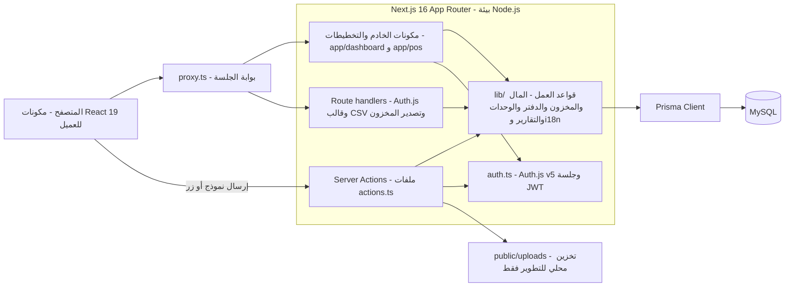
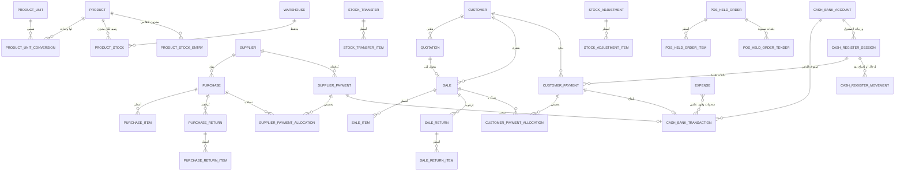
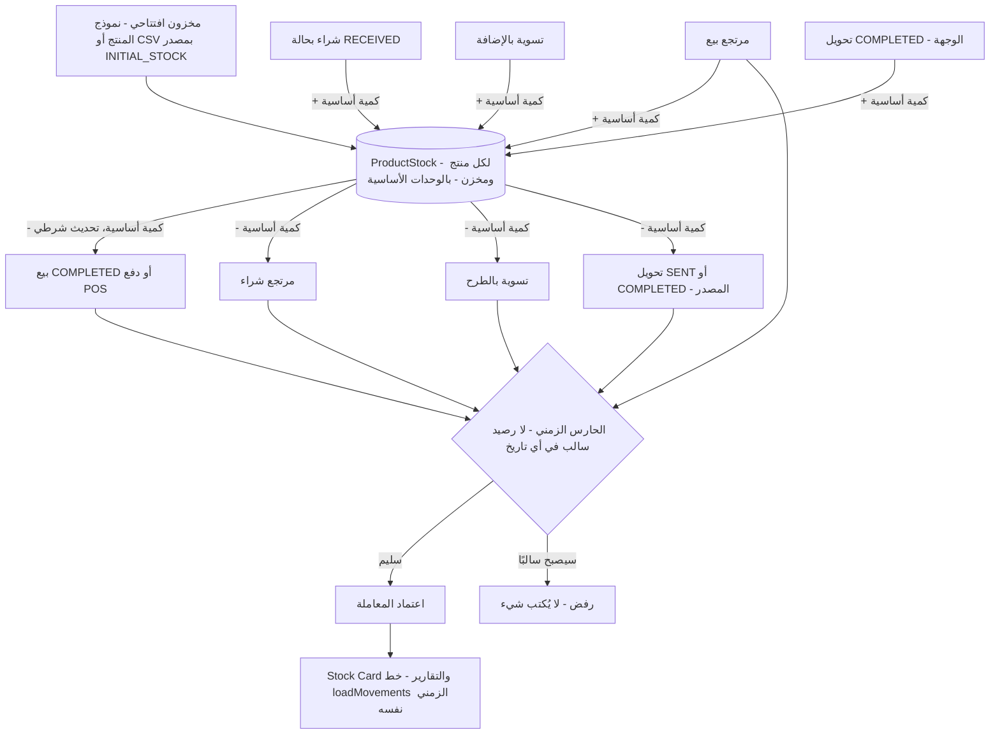
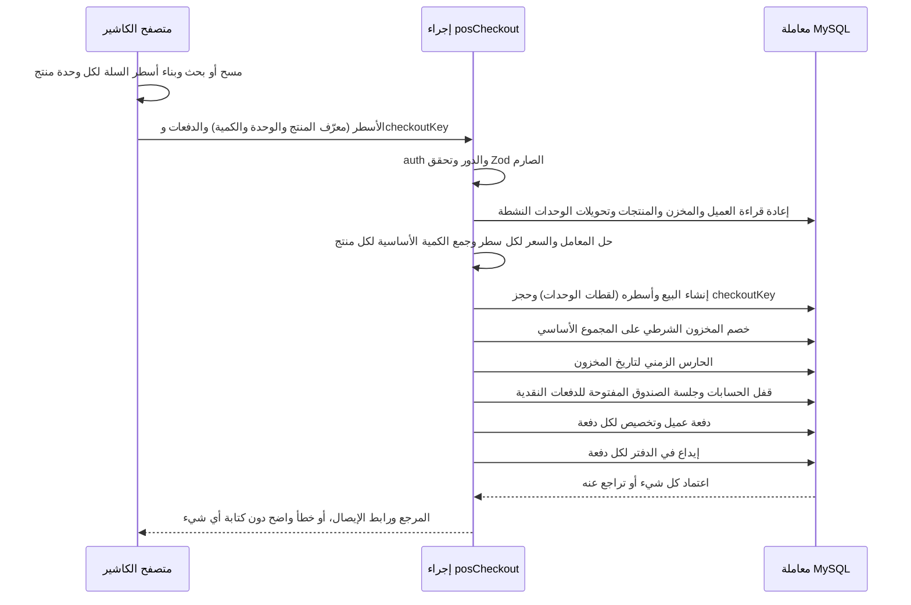
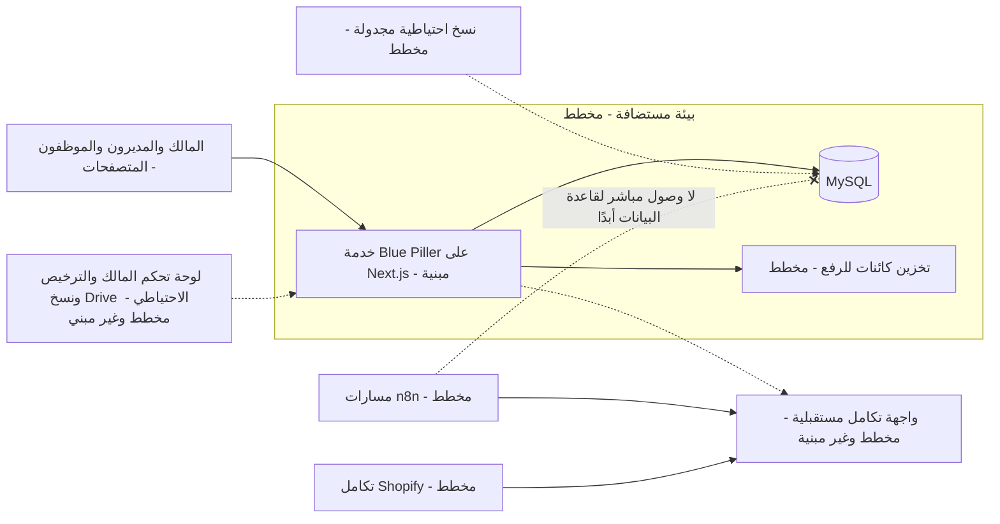

<div dir="rtl" lang="ar">

# Blue Piller — توثيق المشروع (العربية)

> وثيقة تقنية ومنتجية حيّة. آخر مطابقة مع الشيفرة عند الـ commit ‏`ed94d0b` ‏(2026-11-22)، إصدار الحزمة `0.1.0`، و40 migration في Prisma (آخرها `20261203000000_pos_multi_unit_lines`).
> النسخة الإنجليزية: [PROJECT_DOCUMENTATION_EN.md](PROJECT_DOCUMENTATION_EN.md) · الفهرس: [README.md](README.md)
>
> كل ما يلي يصف ما تفعله الشيفرة **اليوم**. البنود الموسومة بـ **مخطط** أو **مؤجل** غير منفّذة.

## المحتويات

1. [نظرة عامة على المشروع](#sec-overview)
2. [البنية المعمارية](#sec-architecture)
3. [المصادقة والتفويض](#sec-auth)
4. [وحدات التطبيق](#sec-modules)
5. [نموذج البيانات](#sec-data-model)
6. [قواعد المخزون](#sec-inventory)
7. [القواعد المالية](#sec-finance)
8. [مسار عمل نقطة البيع POS](#sec-pos)
9. [التقارير والطباعة](#sec-reports)
10. [التوطين واللغات](#sec-i18n)
11. [عمليات قاعدة البيانات والـ migrations](#sec-db-ops)
12. [النشر والجاهزية للإنتاج](#sec-deployment)
13. [Git وسير التغيير](#sec-git)
14. [خارطة الطريق](#sec-roadmap)
15. [سجل القرارات](#sec-decisions)
16. [كيفية صيانة هذا التوثيق](#sec-maintenance)

---

<a id="sec-overview"></a>
## 1. نظرة عامة على المشروع

**Blue Piller** (اسم الحزمة `blue_piller` والاسم التجاري "Bluepiller") نظام ويب لإدارة المخزون ونقطة البيع (POS) للأعمال التجارية الصغيرة والمتوسطة. يغطي المنتجات والمخزون والمشتريات والمبيعات وعروض الأسعار والمرتجعات ومدفوعات الموردين والعملاء والحسابات النقدية والبنكية والمصروفات، وكاشير POS بجلسات صندوق، وتقارير المخزون وطباعة ملصقات الباركود. الواجهة متاحة بالإنجليزية والعربية (من اليمين إلى اليسار).

**المستخدمون المستهدفون**

| الدور | الشخص المعتاد | الملخص |
|---|---|---|
| `OWNER` | مالك النشاط | كل شيء، بما في ذلك Users وSystem Settings وTheme وLanguages وفئات النقد (denominations). |
| `ADMIN` | مدير / محاسب / مشرف كاشير | كل الوحدات التشغيلية (المشتريات، المبيعات، المالية، POS، المخزون، طباعة الباركود). بدون Users وSettings. |
| `USER` | موظف بصلاحية قراءة | قراءة البيانات الأساسية والتحويلات والتسويات فقط؛ بلا شاشات الأموال أو التكلفة أو المبيعات أو المشتريات. |

**حزمة التقنيات** (من `package.json`)

| الطبقة | التقنية |
|---|---|
| الإطار | Next.js `16.4.6` ‏(App Router وTurbopack، مع تفعيل `cacheComponents` و`partialPrefetching`)، وReact `19.3.0`، وTypeScript 5 |
| المصادقة | Auth.js / `next-auth` ‏`5.0.0-beta.32`، موفّر Credentials، جلسات JWT، و`bcryptjs` |
| قاعدة البيانات | MySQL عبر Prisma ‏`6.19` ‏(`provider = "mysql"`، والعميل مُولَّد في `app/generated/prisma`) و`mysql2` |
| التحقق | `zod` 4 (المخططات نفسها للعميل والخادم) |
| مكتبات أخرى | `csv-parse` (استيراد المنتجات)، و`react-hot-toast`، و`lucide-react` (الأيقونات). أما `formidable` و`pdf-parse` و`uuid` فمعلنة في `package.json` لكن لا يستوردها كود التطبيق عند هذا الـ commit. |
| التنسيق | ورقة أنماط عامة واحدة `app/styles.css` ‏(أصناف نظام التصميم `sp-*` وأصناف الهيكل `bp-*`) إضافةً إلى ملفات الرموز `colors.css` و`typography.css` و`spacing.css`. Tailwind 4 مثبّت لمسار CSS لكن التطبيق لا يستخدم أصناف utility. |
| المرجع البصري | `design/*.html` (نحو 80 نموذجًا ثابتًا) |

**حالة التنفيذ (عند الـ commit الموثّق)**

- منفّذ: المصادقة والأدوار، إعدادات النظام، السمة، التفضيلات، التوطين بالإنجليزية/العربية مع تعديلات عربية يديرها المالك، المستخدمون، الملف الشخصي وPIN، العملات، المخازن، بيانات المنتجات الأساسية، تحويلات الوحدات، استيراد المنتجات CSV، تصدير مخزون المخزن CSV، التحويلات، التسويات، الموردون، العملاء، المشتريات، مرتجعات المشتريات، مدفوعات الموردين، عروض الأسعار، المبيعات، مرتجعات المبيعات، مدفوعات العملاء، دفتر النقد والبنك، المصروفات، نقطة البيع (الطلبات المعلّقة، الدفع المجزّأ، العميل العابر، جلسات الصندوق، إدخال/إخراج النقد، عدّ الفئات، شاشة القفل وPIN)، تقارير المخزون، كشوف حساب الموردين والعملاء، طباعة الباركود، وسلة POS متعددة الوحدات.
- أماكن محجوزة فقط (عناصر في القائمة الجانبية أو محتوى تجريبي دون تنفيذ حقيقي): **أرقام لوحة التحكم Dashboard** (الصفحة تستخدم بيانات العرض التجريبية من التصميم)، و**Profit & Loss**، و**Cash Flow**، و**Receivables & Payables Aging**، و**Roles/Permissions**، و**Reports** (الصفحة الفهرس)، و**Email Templates**، و**SMS Templates**. روابط القائمة هذه بلا مسارات (routes) بعد. راجع [خارطة الطريق](#sec-roadmap).
- **لا توجد حزمة اختبارات آلية داخل المستودع** عند هذا الـ commit. جرى التحقق حتى الآن بسكربتات شُغّلت على قواعد بيانات مؤقتة (غير مُودعة). فحوص المستودع هي: فحص الأنواع (`npx tsc --noEmit`) وlint (`npm run lint`) وبناء الإنتاج (`npm run build`).

---

<a id="sec-architecture"></a>
## 2. البنية المعمارية

### 2.1 اللبنات الأساسية

- **Next.js 16 App Router.** الصفحات تحت `app/`. توجد شجرتا مسارات: `app/(dashboard)/…` (هيكل لوحة التحكم: الشريط الجانبي والشريط العلوي والتذييل) و`app/pos/…` (تخطيط ملء الشاشة لنقطة البيع بلا الهيكل). و`app/page.tsx` صفحة تسجيل الدخول عند `/`.
- **Server Components** تقرأ البيانات مباشرةً عبر Prisma ‏(`lib/db.ts`) وتتحقق من الجلسة والدور قبل قراءة أي شيء حساس. معظم صفحات القوائم والتفاصيل تستدعي `await connection()` فتُعرض لكل طلب.
- **Client Components** ‏(`"use client"`) تتولى النماذج وشاشة POS والجداول التفاعلية. لا تحوي قواعد عمل يعتمد عليها الخادم.
- **Server Actions** ‏(`app/**/actions.ts`) هي مسار الكتابة. يعيد كل action قراءة الجلسة بـ `auth()` ويعيد فحص الدور ويتحقق من الحمولة بـ Zod ‏(`.strict()` — المفاتيح غير المعروفة تُرفض) ويعيد قراءة كل السجلات المرتبطة ويعيد حساب كل أثر مالي وتخزيني ثم يكتب داخل معاملة (transaction) في قاعدة البيانات.
- **Route handlers** موجودة فقط حيث يلزم ملف أو استجابة بروتوكول: Auth.js ‏(`app/api/auth/[...nextauth]`)، وقالب CSV للمنتجات (`/products/import/template`)، وتصدير مخزون المخزن (`/warehouse/[id]/export`).
- **`proxy.ts`** (بديل `middleware.ts` في Next.js 16) هو البوابة الأولى: أي طلب بلا جلسة يُحوَّل إلى `/` (عام: `/` و`/api/auth/*` والملفات الثابتة).
- **قواعد العمل في `lib/`** (الحساب العشري الدقيق، خصم المخزون، دفتر النقد والبنك، تحويل الوحدات، الحراسات الزمنية، التقارير، i18n). تستوردها الصفحات والـ actions ليكون لكل مدخل (المبيعات وPOS والاستيراد) تنفيذ واحد مشترك.
- **الأنماط العامة والهيكل.** تستورد الشاشة الجذر `app/styles.css` مرة واحدة. هيكل لوحة التحكم (`components/layout/`) يوفّر `Sidebar` و`Topbar` و`Footer`؛ والتنقل معرَّف في `components/layout/nav.ts` ومُرشَّح بحسب الدور. يُحقن ثيم المالك وثيم كل مستخدم كمتغيرات CSS.

> يحذّر `AGENTS.md` من أن إصدار Next.js هذا يختلف عن الإصدارات الأقدم. اقرأ الدليل المناسب في `node_modules/next/dist/docs/` قبل تعديل كود على مستوى الإطار.

### 2.2 مخطط البنية المعمارية



### 2.3 نمط معالجة الطلب

1. يرفض `proxy.ts` الطلبات المجهولة.
2. يستدعي تخطيط لوحة التحكم (`app/(dashboard)/layout.tsx`) الدالة `auth()` مرة أخرى ويحوّل إلى `/` إن لم يوجد مستخدم.
3. تفحص كل صفحة دالة الدور من `lib/roles.ts` (مثل `canManagePurchases`) وتحوّل **قبل** تحميل أي بيانات.
4. تمر الكتابة عبر Server Action يكرر فحص الدور ويتحقق من كل شيء مجددًا.
5. تفرض قاعدة البيانات ما تستطيع (مفاتيح فريدة، علاقات `RESTRICT`، قيود CHECK).

---

<a id="sec-auth"></a>
## 3. المصادقة والتفويض

### 3.1 الأدوار

`enum Role { OWNER ADMIN USER }` (الافتراضي للمستخدمين الجدد: `USER`). يوجد `OWNER` أساسي واحد يُنشأ بسكربت البذر (`npx prisma db seed` الذي يقرأ متغيرات `SEED_ADMIN_*`). لا يمكن إسناد `OWNER` من شاشة Users، ولا يمكن تعديل حسابه إلى دور آخر ولا حذفه. لا يوجد تسجيل ذاتي.

### 3.2 طبقات الحماية

| # | الطبقة | ما تفعله |
|---|---|---|
| 1 | `proxy.ts` | يحوّل أي طلب بلا جلسة صالحة إلى `/`. |
| 2 | تخطيطات وصفحات لوحة التحكم / POS | `auth()` مع دالة دور (`lib/roles.ts`)؛ الأدوار غير المصرّح لها تُحوَّل قبل قراءة البيانات. |
| 3 | ترشيح الشريط الجانبي | يخفي `visibleNav(role)` ما لا يستطيع الدور استخدامه. هذا للراحة فقط. |
| 4 | Server Actions وroute handlers | إعادة قراءة `auth()` في كل استدعاء، وإعادة فحص الدور، والتحقق من الحمولة بـ Zod ‏`.strict()`. لا يؤخذ الدور ولا معرّف المستخدم ولا الأسعار من المتصفح أبدًا. |
| 5 | قاعدة البيانات | فهارس فريدة، وعلاقات `RESTRICT`، وجداول للإلحاق فقط بالاتفاق، وقيود CHECK (مثل صيغة الباركود). |

### 3.3 الجلسات وإبطالها

- الاستراتيجية: **JWT** ‏(`session: { strategy: "jwt" }`)، صفحة الدخول `/`، موفّر Credentials (بريد + كلمة مرور، مقارنة تجزئة bcrypt).
- عند **كل** قراءة للجلسة (proxy والتخطيطات والصفحات وServer Actions) يعيد callback الـ `jwt` قراءة المستخدم من MySQL: الحساب المحذوف تنتهي جلسته فورًا؛ والدور والاسم والبريد والصورة تعكس دائمًا قاعدة البيانات.
- يُرفع `User.sessionVersion` عند تغيير كلمة المرور أو إعادة تعيينها. يُرفض أي توكن يحمل إصدارًا أقدم عند طلبه التالي. وتبقى الجلسة التي أجرت تغيير كلمة المرور الذاتي حيّة عبر منحة لمرة واحدة من جهة الخادم (`lib/session-upgrade.ts`)؛ ولا يستطيع المتصفح تزويرها.
- كلمات المرور: 8 أحرف على الأقل، مجزَّأة بـ `bcryptjs` ‏(cost 12). لا تُرسل التجزئات (ولا تجزئات PIN) إلى المتصفح أبدًا.
- شاشة قفل POS **قفل واجهة فقط** (راجع [مسار عمل نقطة البيع POS](#sec-pos))؛ لا تلمس جلسة Auth.js.

### 3.4 مصفوفة الصلاحيات

`R` = قراءة فقط، `M` = إدارة (إنشاء/تعديل بحسب ما تسمح به الوحدة)، `—` = لا وصول (تحويل بلا بيانات). المصادر: `lib/roles.ts` وحراسات الصفحات و`nav.ts`.

| المجال | OWNER | ADMIN | USER |
|---|:-:|:-:|:-:|
| Dashboard (أرقام تجريبية)، الملف الشخصي، تغيير كلمة المرور، التفضيلات الشخصية/اللغة | M | M | M |
| المنتجات، الفئات، العلامات التجارية، الوحدات، Base Units، المخازن، العملات (القوائم) | M | M | R |
| الموردون، العملاء (القوائم) | M | M | R |
| التحويلات، التسويات (القوائم/التفاصيل؛ التكاليف مخفية عن USER) | M | M | R |
| إنشاء/تعديل المنتج، استيراد CSV، تصدير مخزون المخزن، Print Barcode | M | M | — |
| المشتريات، مرتجعات المشتريات، مدفوعات الموردين، كشف حساب المورد | M | M | — |
| عروض الأسعار، المبيعات، مرتجعات المبيعات، مدفوعات العملاء، كشف حساب العميل | M | M | — |
| حسابات/حركات النقد والبنك، المصروفات، فئات المصروفات | M | M | — |
| تقارير المخزون (وصفحات تقاريرها) | R | R | — |
| POS، الطلبات المعلّقة، الصناديق، الإيصالات، تقرير جلسة الصندوق | M | M | — |
| PIN الكاشير (يُضبط في الملف الشخصي) | M | M | — |
| Users | M | — | — |
| إعدادات النظام، الثيم (العام)، فئات النقد، Languages (تعديلات الترجمة)، إعداد العميل العابر | M | — | — |

---

<a id="sec-modules"></a>
## 4. وحدات التطبيق

تُولَّد أرقام المراجع على الخادم من عدّادات MySQL ‏`AUTO_INCREMENT` ولا يعاد استخدامها: ‏`SA_` المبيعات، `PU_` المشتريات، `PR_` مرتجعات المشتريات، `SR_` مرتجعات المبيعات، `QU_` عروض الأسعار، `TR_` التحويلات، `AD_` التسويات، `SP_` مدفوعات الموردين، `CP_` مدفوعات العملاء، `EX_` المصروفات، `HO_` الطلبات المعلّقة في POS، `RS_` جلسات الصندوق، `RM_` حركات الصندوق، و`DEP_` / `WDR_` / `TRF_` لصفوف الدفتر.

### 4.1 الإعدادات والمظهر واللغة

| الوحدة | المسار(ات) | الأدوار | الغرض والقواعد الأساسية |
|---|---|---|---|
| System Settings | `/settings` | OWNER | صف وحيد `SystemSettings` ‏(المعرّف 1): اسم الشركة وشعارها وبيانات الاتصال، العملة الافتراضية، الدولة/الولاية/المدينة، صيغة التاريخ، نص التذييل، وعميل POS العابر الاختياري. رفع الشعار تخزين محلي للتطوير. |
| Theme (عام) | `/settings/theme` | OWNER | JSON ثيم مُتحقَّق منه في `SystemSettings.theme` يُحوَّل إلى متغيرات CSS على الخادم. |
| Preferences | `/preferences` | كل الأدوار | ثيم ولغة كل مستخدم في `UserPreference`؛ يتقدم على الثيم العام لذلك المستخدم فقط. |
| Languages / Translation Management | `/settings/languages` | OWNER | تعديل **النص العربي** لأي مفتاح في الكتالوج (`TranslationOverride`)؛ لا يُخزَّن الإنجليزي أبدًا. راجع [التوطين واللغات](#sec-i18n). |
| Cash Denominations | `/settings/denominations` | OWNER | قيم الأوراق والعملات المعدنية لكل عملة تُستخدم لعدّ الدرج عند إغلاق الصندوق. الفئة المستخدمة في عدّ مغلق تُعطَّل ولا تُحذف. |

### 4.2 المستخدمون والملف الشخصي والأمان

| الوحدة | المسار(ات) | الأدوار | الغرض والقواعد الأساسية |
|---|---|---|---|
| Users | `/users` و`/users/create` و`/users/[id]/edit` | OWNER | إنشاء/تعديل/حذف حسابات `ADMIN` و`USER`. يُرفض الحذف إذا كان المستخدم مؤلفًا لسجلات عمل. الصورة: JPG/PNG/WebP بحد 2 MB. |
| Profile | `/profile` | كل الأدوار | الاسم/الاتصال/الصورة الخاصة. قسم PIN الكاشير متاح لـ `OWNER` و`ADMIN`. |
| Change Password | `/change-password` | كل الأدوار | يرفع `sessionVersion`؛ تنتهي الجلسات الأخرى وتبقى الجلسة الحالية. |
| POS Cashier PIN | في `/profile` | OWNER, ADMIN | PIN اختياري (تجزئة bcrypt في `users.posPinHash`) لا يفتح سوى شاشة قفل POS. تُرفض الأرقام الضعيفة (كلها متساوية أو متتابعة تصاعديًا/تنازليًا). وهو ليس وسيلة دخول أبدًا. |

### 4.3 البيانات الأساسية والمنتجات

| الوحدة | المسار(ات) | الأدوار | الغرض والقواعد الأساسية |
|---|---|---|---|
| Currencies | `/currencies` | العرض: الكل · الإدارة: OWNER, ADMIN | رمز فريد من 3 أحرف. **العملة الافتراضية في System Settings** تُستخدم لكل المستندات؛ لا يوجد تحويل بين عملات. |
| Warehouses | `/warehouse` و`/warehouse/create` و`/warehouse/[id]/edit` | العرض: الكل · الإدارة: OWNER, ADMIN | اسم فريد؛ يُرفض الحذف ما دام المخزون أو المستندات تشير إليه. |
| Categories / Brands / Units | `/products/categories` و`/products/brands` و`/products/units` | العرض: الكل · الإدارة: OWNER, ADMIN | أسماء فريدة. الوحدة (Unit) مجرد **تسمية** قابلة لإعادة الاستخدام (Piece وBox…)؛ والمعامل (factor) يخص كل منتج. يُرفض الحذف ما دامت مستخدمة، بما فيه استخدامها وحدة عبوة لمنتج. |
| Products | `/products` و`/products/create` و`/products/[id]/edit` | العرض: الكل · الإنشاء/التعديل: OWNER, ADMIN | `code` فريد بأحرف كبيرة؛ التكلفة/السعر `DECIMAL(14,2)`؛ الكميات `DECIMAL(14,3)`؛ نسبة الضريبة ونوعها (`EXCLUSIVE`/`INCLUSIVE`)؛ تنبيه المخزون؛ حتى 5 صور (JPG/PNG/WebP بحد 2 MB لكل صورة). الإنشاء يسجّل قيد مخزون افتتاحي (المورد والمخزن والكمية والحالة؛ لا يغيّر المخزون إلا الحالة `RECEIVED`). **لا يمكن حذف المنتجات** (لا يوجد action للحذف). |
| Base Units / Product Units | `/base-units` (عرض) وقسم *Product Units* في نموذج المنتج | العرض: الكل · التعديل: OWNER, ADMIN | راجع [قواعد المخزون](#sec-inventory). وحدة أساسية واحدة لكل منتج، ووحدات إضافية بمعامل موجب، وغرض مبيعات/مشتريات، وعلم تفعيل، وباركود واحد لكل وحدة. |
| CSV Product Import | نافذة في `/products`؛ القالب `/products/import/template` | OWNER, ADMIN | إنشاء فقط، معاينة ثم تأكيد في معاملة واحدة؛ حتى 1000 صف و5 MB؛ عمود `Unit` يصبح **الوحدة الأساسية** للمنتج؛ و`Opening Stock` يُسجَّل كـ `INITIAL_STOCK` (بلا مورد ولا شراء ولا ذمة دائنة ولا قيد في الدفتر)؛ ورمز المنتج يصبح باركود الوحدة الأساسية إن كان صالحًا. المنتجات الموجودة لا تتغير أبدًا. |
| Warehouse Stock Export | `/warehouse/[id]/export` (CSV) | OWNER, ADMIN | مخزون كل منتج في مخزن واحد؛ والعناوين تقول *Base Unit* و*In Stock (base unit)*. |
| Print Barcode | `/print-barcode` و`/print-barcode/labels` | OWNER, ADMIN | راجع [التقارير والطباعة](#sec-reports). |

### 4.4 عمليات المخزون

| الوحدة | المسار(ات) | الأدوار | الغرض والقواعد الأساسية |
|---|---|---|---|
| Transfers | `/transfers` و`/transfers/create` و`/transfers/[id]` و`/transfers/[id]/edit` | العرض: الكل · الإدارة: OWNER, ADMIN | بين مخزنين. الحالة `PENDING` (بلا أثر على المخزون) ← `SENT` (يخصم من المصدر) ← `COMPLETED` (يخصم من المصدر إن لم يُخصم ويضيف إلى الوجهة). `SENT`/`COMPLETED` تاريخ لا يُحذف؛ و`COMPLETED` غير قابل للتعديل. تحفظ الأسطر لقطة الوحدة والمعامل والكمية الأساسية. |
| Adjustments | `/adjustments` و`/adjustments/create` و`/adjustments/[id]/edit` | العرض: الكل · الإدارة: OWNER, ADMIN | إضافة/طرح يدوي لكل مخزن. الإنشاء/التعديل/الحذف تطبّق أو تعكس الأثر الصافي في معاملة واحدة؛ لا ينزل المخزون تحت الصفر ولا يصير التاريخ سالبًا. |

### 4.5 المشتريات والموردون

| الوحدة | المسار(ات) | الأدوار | الغرض والقواعد الأساسية |
|---|---|---|---|
| Suppliers | `/suppliers` و`/suppliers/create` و`/suppliers/[id]/edit` | العرض: الكل · الإدارة: OWNER, ADMIN | اسم فريد؛ يُرفض الحذف ما دام مُشارًا إليه. |
| Purchases | `/purchases` و`/purchases/create` و`/purchases/[id]` | OWNER, ADMIN | تُعاد الإجماليات على الخادم (تقريب half-up إلى أقرب قرش) وتُحفظ كلقطة. الحالة `RECEIVED` / `PENDING` / `ORDERED`؛ يُضاف المخزون مرة واحدة عند `RECEIVED` (عند الإنشاء أو بـ *Mark as Received*). تحمل الأسطر لقطات الوحدة. المشتريات غير قابلة للتعديل بعد الإنشاء (لا تعديل/حذف). |
| Purchase Returns | `/purchases/returns` و`/purchases/returns/create` و`/purchases/returns/[id]` | OWNER, ADMIN | فقط من مشترى `RECEIVED`؛ الكمية ≤ المشتراة − المرتجعة سابقًا (بوحدة السطر الأصلي وبالوحدات الأساسية)؛ يُخصم المخزون بتحديث شرطي؛ تُوزَّع المبالغ نسبيًا من لقطة المشترى؛ يخفّض المستحق (Due). غير قابل للتعديل. لا مسار استرداد/رصيد. |
| Supplier Payments | `/supplier-payments` و`/supplier-payments/record` | OWNER, ADMIN | راجع [القواعد المالية](#sec-finance). |
| Supplier Statement | `/suppliers/statement` ← التقرير `/reports/supplier-statement` | OWNER, ADMIN | مشتريات ومرتجعات ومدفوعات وأرصدة مورد واحد (تقرير صالح للطباعة). |

### 4.6 المبيعات والعملاء

| الوحدة | المسار(ات) | الأدوار | الغرض والقواعد الأساسية |
|---|---|---|---|
| Customers | `/customers` و`/customers/create` و`/customers/[id]/edit` | العرض: الكل · الإدارة: OWNER, ADMIN | اسم فريد؛ يُرفض الحذف ما دام مُشارًا إليه (بما في ذلك كونه عميل POS العابر). |
| Quotations | `/quotations` و`/quotations/create` و`/quotations/[id]` و`/quotations/[id]/edit` | OWNER, ADMIN | عرض تجاري فقط: بلا أثر على المخزون أو الدفتر أو الأرصدة. دورة الحياة `DRAFT ← SENT ← ACCEPTED \| REJECTED \| EXPIRED`؛ ولا يُعدَّل/يُحذف إلا `DRAFT`. أسطر العرض بـ**الوحدة الأساسية** لكل منتج فقط (تُرفض وحدات العبوات على الخادم). العرض `ACCEPTED` يتحول مرة واحدة إلى بيع `PENDING`. |
| Sales | `/sales` و`/sales/create` و`/sales/[id]` و`/sales/[id]/edit` | OWNER, ADMIN | `PENDING` أو `COMPLETED`. يُخصم المخزون عندما يصبح البيع `COMPLETED` (تحديث شرطي، الكل أو لا شيء). لا يُعدَّل أو يُحذف إلا البيع `PENDING`. تُؤخذ لقطة وحدة السطر ومعامله وكميته الأساسية على الخادم. تُسجَّل المدفوعات منفصلة (Customer Payments) وتُتتبَّع في `Sale.paidAmount`. |
| Sales Returns | `/sales/returns` و`/sales/returns/create` و`/sales/returns/[id]` | OWNER, ADMIN | فقط المبيعات `COMPLETED`؛ الكمية ≤ المباعة − المرتجعة (لكل سطر وبوحدته)؛ يعود المخزون إلى مخزن البيع؛ ولا يتجاوز مبلغ المرتجع المستحق غير المدفوع على البيع. غير قابل للتعديل. **الاسترداد ورصيد العميل للمبالغ المدفوعة غير مبنيين** — ولذلك لا يمكن بعدُ إرجاع بيع مدفوع بالكامل (بما فيه كل بيع POS). |
| Customer Payments | `/customer-payments` و`/customer-payments/record` | OWNER, ADMIN | راجع [القواعد المالية](#sec-finance). |
| Customer Statement | `/customers/statement` ← التقرير `/reports/customer-statement` | OWNER, ADMIN | مبيعات ومرتجعات ومدفوعات وأرصدة عميل واحد. |

### 4.7 المالية

مجموعة *Finance* في الشريط الجانبي تحوي الوحدات أدناه فقط. أما *Profit & Loss* و*Cash Flow* و*Receivables & Payables Aging* فهي **عناصر قائمة محجوزة بلا مسارات** (مخطط).

| الوحدة | المسار(ات) | الأدوار | الغرض والقواعد الأساسية |
|---|---|---|---|
| Cash & Bank Accounts | `/finance/accounts` | OWNER, ADMIN | حسابات من نوع `CASH` أو `BANK`، و`ACTIVE`/`INACTIVE`. الرصيد الافتتاحي يُحدَّد مرة واحدة؛ **لا يوجد رصيد مخزَّن** (يُحسب من الدفتر). تُعطَّل الحسابات ولا تُحذف. لا يمكن تعطيل حساب له صندوق مفتوح أو تحويله إلى حساب بنكي. |
| Cash & Bank Transactions | `/finance/transactions` | OWNER, ADMIN | إيداع وسحب وتحويل داخلي يدوي على دفتر للإلحاق فقط. |
| Expenses | `/expenses` و`/expenses/create` و`/expenses/[id]/edit` | OWNER, ADMIN | كل مصروف يُدفع من حساب (سحب `WITHDRAWAL` في الدفتر). التعديل يُلحق إيداع عكس `DEPOSIT` وسحبًا جديدًا `WITHDRAWAL`؛ والحذف حذف ناعم (`deletedAt`) مع قيد عكس. |
| Expense Categories | `/expenses/categories` | OWNER, ADMIN | أسماء فريدة؛ يُرفض الحذف ما دامت مستخدمة. |

### 4.8 نقطة البيع POS

| الوحدة | المسار(ات) | الأدوار | الغرض والقواعد الأساسية |
|---|---|---|---|
| POS | `/pos` (ملء الشاشة) | OWNER, ADMIN | التفاصيل في [مسار عمل نقطة البيع POS](#sec-pos). الدفع، والطلبات المعلّقة، والدفع المجزّأ (حتى 5 دفعات)، والعميل العابر، وجلسات الصندوق، وإدخال/إخراج النقد، وعدّ الفئات، وشاشة القفل. |
| Receipt | `/reports/pos-receipt/[saleId]` | OWNER, ADMIN | إيصال POS قابل للطباعة بكل الدفعات. |
| Register Session Report | `/reports/register-session/[sessionId]` | OWNER, ADMIN | تقرير وردية قابل للطباعة (الافتتاح، الدفعات، إدخال/إخراج النقد، النقد المتوقع مقابل المعدود). |

### 4.9 طباعة الباركود وسلة POS متعددة الوحدات

- **الباركود** يخص *وحدة منتج* (باركود واحد اختياري فريد عالميًا لكل صف وحدة). يُدار من نموذج المنتج (OWNER/ADMIN). قواعد الصيغة والتفرّد في [قواعد المخزون](#sec-inventory).
- **Print Barcode** ‏(`/print-barcode`): اختر المنتجات والوحدات وعدد الملصقات والورق (A4 أو US Letter) والتخطيط، ثم *View Labels* يفتح `/print-barcode/labels` وهو المكان الوحيد الذي فيه زر **Print Barcode**. للقراءة فقط.
- **سلة POS متعددة الوحدات:** سطر السلة هو *وحدة منتج*. "Water × 1 Box" و"Water × 2 Piece" سطران؛ ومسح باركود يضيف واحدًا من تلك الوحدة بعينها؛ ويُفحص المخزون على **مجموع** أسطر المنتج كلها.

### 4.10 تقارير المخزون

| التقرير | صفحة المعاملات | مسار التقرير | الأدوار |
|---|---|---|---|
| Stock Balance by Warehouse | `/inventory-reports/stock-balance` | `/reports/stock-balance` | OWNER, ADMIN |
| Product Movement (Stock Card) | `/inventory-reports/product-movement` | `/reports/product-movement` | OWNER, ADMIN |
| Low Stock Items | `/inventory-reports/low-stock` | `/reports/low-stock` | OWNER, ADMIN |

التقارير للقراءة فقط وبالوحدات الأساسية، وتُفتح من *View Report* إلى صفحة صالحة للطباعة.

---

<a id="sec-data-model"></a>
## 5. نموذج البيانات

يضم المخطط **45 نموذجًا و19 enum** (`prisma/schema.prisma`). الأعراف: المفاتيح الأساسية `cuid()`؛ المال `DECIMAL(14,2)` والكميات `DECIMAL(14,3)` ومعاملات الوحدات `DECIMAL(16,6)` — لا فاصلة عائمة أبدًا؛ علاقات البيانات الأساسية `RESTRICT` فلا يُحذف سجل مُشار إليه؛ وتحتفظ المستندات بـ**لقطاتها** (الرمز والاسم والوحدة والسعر والضريبة) فلا يعيد تعديل البيانات الأساسية كتابة التاريخ.

### 5.1 العلاقات الأساسية بين الكيانات



### 5.2 مجموعات الكيانات

| المجموعة | النماذج | ملاحظات |
|---|---|---|
| الهوية والإعدادات | `User` و`UserPreference` و`SystemSettings` و`TranslationOverride` و`Currency` و`CurrencyDenomination` | `SystemSettings` صف وحيد (المعرّف 1). و`User.sessionVersion` و`posPinHash` يدعمان إبطال الجلسات وPIN الخاص بـ POS. |
| البيانات الأساسية | `Warehouse` و`ProductCategory` و`Brand` و`ProductUnit` و`Supplier` و`Customer` و`ExpenseCategory` | أسماء فريدة (ترتيب غير حساس لحالة الأحرف)؛ حذف `RESTRICT`. |
| المنتجات | `Product` و`ProductImage` و`ProductUnitConversion` | `ProductUnitConversion` = وحدة لكل منتج: `factor` و`isBase` و`active` و`forSales` و`forPurchases` و`barcode` فريد قابل للإفراغ. |
| المخزون | `ProductStock` و`ProductStockEntry` و`StockTransfer(+Item)` و`StockAdjustment(+Item)` | `ProductStock` هو الكمية المتاحة المحفوظة لكل منتج + مخزن. |
| المشتريات | `Purchase(+Item)` و`PurchaseReturn(+Item)` و`SupplierPayment` و`SupplierPaymentAllocation` | |
| المبيعات | `Quotation(+Item)` و`Sale(+Item)` و`SaleReturn(+Item)` و`CustomerPayment` و`CustomerPaymentAllocation` | `Sale.posCheckoutKey` (فريد) يجعل دفع POS مرادفًا للتكرار الآمن (idempotent)؛ و`Sale.quotationId` فريد (تحويل واحد). |
| المالية | `CashBankAccount` و`CashBankTransaction` و`Expense` | تربط صفوف الدفتر بالمستند الذي أنتجها (`supplierPaymentId` و`customerPaymentId` و`expenseId`). |
| POS | `PosHeldOrder` و`PosHeldOrderItem` و`PosHeldOrderTender` و`CashRegisterSession` و`CashRegisterMovement` و`CashRegisterCount` | `openAccountKey` (فريد) يضمن جلسة مفتوحة واحدة لكل حساب. |

### 5.3 الحفظ بحسب الموضوع

**المخزون.** تُخزَّن الكمية الحالية في `ProductStock` (لكل منتج + مخزن، بالوحدات الأساسية). ولا تتغير إلا داخل معاملات بتحديثات شرطية. التاريخ هو مجموعة المستندات غير القابلة للتعديل (قيود المخزون الافتتاحي وأسطر الشراء/المرتجع/البيع/مرتجع البيع/التحويل/التسوية)؛ ويشتق Stock Card الخط الزمني للحركات منها.

**المال.** **لا يوجد رصيد حساب مخزَّن.** رصيد `CashBankAccount` هو `openingBalance + الإيداعات − السحوبات − التحويلات الخارجة + التحويلات الداخلة` محسوبًا من صفوف `CashBankTransaction` للإلحاق فقط. إجماليات المستندات (`subtotal` والضرائب والخصومات و`grandTotal`) لقطات تحسبها الخادم؛ والمبلغ المدفوع يُخزَّن على المستند (`Sale.paidAmount` و`Purchase.paidAmount`) ولا يتحرك إلا بتخصيصات الدفع.

**تاريخ المستندات.** المستندات وأسطرها لقطات. لا تنسخ الأسطر الباركود أبدًا، فتغيير الباركود لا يعيد كتابة التاريخ. تحمل أسطر المشتريات والمرتجعات والمبيعات والتحويلات والتسويات: `unitId` (القيمة الفارغة = قديم بمعامل 1) و`unitName` و`unitFactor` والكمية المُدخلة `quantity` و`baseQuantity` (أثر المخزون).

---

<a id="sec-inventory"></a>
## 6. قواعد المخزون

### 6.1 الوحدات الأساسية والتحويلات

- لكل منتج **وحدة أساسية واحدة بالضبط** (`Product.productUnitId`، وصف تحويل `isBase = true` بمعامل 1). **كل المخزون يُخزَّن ويُفحص ويُبلَّغ عنه بالوحدات الأساسية.**
- الوحدات الإضافية (Box وCarton…) صفوف في `ProductUnitConversion` بمعامل `factor` موجب تمامًا (عدد الوحدات الأساسية في العبوة، حتى 6 منازل عشرية)، فريدة لكل منتج + وحدة، مع علم `active` وغرض (مبيعات أو مشتريات أو كلاهما). الوحدتان الافتراضيتان للبيع والشراء يجب أن تكونا وحدتين نشطتين مفعّلتين لذلك الغرض.
- **حساب دقيق:** حاصل ضرب الكمية المُدخلة في المعامل يُحسب بأعداد صحيحة (`lib/unit-math.ts`). يجب أن تكون النتيجة دقيقة ضمن 3 منازل عشرية وإلا **يُرفض السطر ولا يُقرَّب أبدًا**. سعر الوحدة الافتراضي = سعر المنتج الأساسي × المعامل (half-up إلى القرش)؛ ولا توجد قوائم أسعار ولا خصومات عبوات.
- **السلطة للخادم:** يرسل المتصفح معرّف الوحدة كمحدِّد فقط. يحل الخادم المعامل والكمية الأساسية والسعر من تحويلات المنتج النشطة نفسه. تُرفض الوحدات أو المعاملات أو الكميات الأساسية أو الأسعار المزوّرة.
- **قواعد السلامة:** لا تتغير الوحدة الأساسية متى صار للمنتج مخزون أو تاريخ أو مستندات. التحويل الذي استخدمه أي مستند يحتفظ بمعامله ولا يمكن إلا تعطيله. لا تُحذف الوحدات المشار إليها من المنتجات. تعطيل وحدة يخفيها عن المستندات الجديدة وPOS والملصقات لكنه يبقي التاريخ.
- **سلوك الـ migration:** حصلت المنتجات الموجودة على تعيين أساسي بمعامل 1 من وحدتها؛ وعوملت الأسطر التاريخية بمعامل 1 (`baseQuantity = quantity` و`unitId = NULL`).

### 6.2 الباركود (لكل وحدة منتج)

- باركود واحد اختياري لكل صف وحدة؛ فريد عبر **كل المنتجات** (فهرس فريد غير حساس لحالة الأحرف).
- التطبيع: قص الفراغات؛ أحرف ASCII القابلة للطباعة فقط (Code 128 subset B، من `0x20` إلى `0x7E`)؛ من 1 إلى 20 حرفًا؛ وتُحفظ حالة الأحرف. ويفرض CHECK في قاعدة البيانات الشيء نفسه.
- لا يجوز أن يساوي الباركود **رمز منتج** آخر (Product Code) حتى لا يتعارض المسح مع البحث بالرمز. تبقى الوحدات المعطلة محتفظة بباركودها محجوزًا.
- يُعبَّأ باركود الوحدة الأساسية افتراضيًا من رمز المنتج عندما يكون الرمز صالحًا وحرًا (قيمة فارغة في نموذج المنتج، واستيراد CSV، وتعبئة الـ migration). وإلا لا يكون للوحدة باركود ولا يمكن طباعتها أو مسحها.
- رمز المنتج (SKU) والباركود معرّفان مختلفان يتطابقان ابتداءً فقط في الوحدة الأساسية.

### 6.3 أثر المستندات على المخزون

| المستند | الأثر على المخزون (بالوحدات الأساسية) |
|---|---|
| إنشاء منتج (النموذج) | قيد `ProductStockEntry` بمصدر `PRODUCT_FORM` (يتطلب موردًا كما هو مسجّل)؛ ويزيد المتاح فقط إذا كانت حالته `RECEIVED`. |
| استيراد CSV | قيد `ProductStockEntry` بمصدر `INITIAL_STOCK`: بلا مورد ولا شراء ولا ذمة ولا قيد في الدفتر. |
| الشراء | `RECEIVED` يضيف مرة واحدة؛ و`PENDING`/`ORDERED` لا يغيّران شيئًا حتى يُعلَّم مستلَمًا. |
| مرتجع الشراء | يخصم (شرطيًا، لا تحت الصفر أبدًا). |
| البيع / بيع POS | يخصم عندما يكون `COMPLETED` (في POS: دائمًا عند الدفع). تُجمع كل أسطر المنتج الواحد قبل فحص التوفر. |
| مرتجع البيع | يعيد إلى مخزن البيع. |
| التحويل | `SENT` يخصم من المصدر؛ و`COMPLETED` يضيف إلى الوجهة (ويخصم من المصدر إن لم يُرسَل بعد). |
| التسوية | `ADDITION` تضيف و`SUBTRACTION` تخصم؛ والتعديل/الحذف يعكسان الأثر الصافي. |
| عرض السعر / الطلب المعلّق في POS | لا شيء. |

### 6.4 تاريخ المخزون والحارس الزمني

فحوص المخزون الحالي لا تثبت إلا أن المخزون غير سالب **الآن**. أما مستند مؤرَّخ في الماضي (مرتجع أو تحويل أو تسوية) فيغيّر أيضًا كل رصيد لاحق. يعيد `lib/stock-history-guard.ts` بناء الخط الزمني للمنتج + المخزن المتأثر داخل معاملة الكتابة ويرفض العملية إذا صار أي رصيد من النقطة المتغيّرة فصاعدًا سالبًا. يعيد قفل صفوف المخزون، ويعمل تحت `READ COMMITTED`، ويستخدم الدالة `loadMovements` نفسها التي يستخدمها Stock Card، فيتفق التقرير والحارس دائمًا. أما المخزون الموجود بلا حركات مسجّلة فيُعامل كرصيد افتتاحي عند بداية الزمن (ولا يُختلق كحركة أبدًا).

### 6.5 مسار حركة المخزون



---

<a id="sec-finance"></a>
## 7. القواعد المالية

- **دفتر للإلحاق فقط.** صفوف `CashBankTransaction` (`DEPOSIT` و`WITHDRAWAL` و`TRANSFER`) لا تُعدَّل ولا تُحذف أبدًا. التصحيحات صفوف جديدة (مثلًا تعديل مصروف يُلحق إيداع عكس وسحبًا جديدًا).
- **لا رصيد مخزَّن.** يُعاد حساب رصيد الحساب من صفوف الدفتر المعتمدة بينما صفوف الحساب مقفلة (`SELECT … FOR UPDATE` بترتيب المعرّف، دون deadlock).
- **السحب على المكشوف والتأريخ الرجعي.** المال الخارج يحتاج رصيدًا *حاليًا* كافيًا ويجب ألا يجعل الرصيد الجاري *الزمني* سالبًا في أي تاريخ (`lib/cash-bank-ledger.ts` المشترك بين Cash & Bank والمصروفات ومدفوعات الموردين). أما المال الداخل (إيصالات العملاء) فلا يسبب رصيدًا سالبًا ولا يحتاج هذا الفحص.
- **العملة.** يجب أن تكون الحسابات نشطة وبعملة المستند؛ وتُستخدم العملة الافتراضية من System Settings للمستندات الجديدة.
- **مدفوعات الموردين** (`/supplier-payments/record`): غير قابلة للتعديل؛ تُخصَّص كل دفعة **بالكامل** على مشتريات ذلك المورد (المبلغ = مجموع التخصيصات). يجب أن يكون كل تخصيص > 0 و≤ مستحق المشترى = `الإجمالي − المدفوع − المرتجعات المكتملة`، يُعاد قراءته تحت أقفال الصفوف. ولا يسبق تاريخ الدفعة تاريخ المشترى. وتزيد `Purchase.paidAmount` وتُلحق سحبًا `WITHDRAWAL` واحدًا في الدفتر.
- **مدفوعات العملاء** (`/customer-payments/record`): غير قابلة للتعديل؛ تُخصَّص بالكامل على مبيعات العميل `COMPLETED`، وكل تخصيص ≤ مستحق البيع = `max(0, الإجمالي − المرتجعات المكتملة − المدفوع)`. وتزيد `Sale.paidAmount` وتُلحق إيداعًا `DEPOSIT` واحدًا في الدفتر.
- **POS** يكتب بيعًا ودفعة عميل لكل دفعة (مخصصة لذلك البيع) وإيداعًا في الدفتر لكل دفعة، كل ذلك في المعاملة نفسها.
- **الصناديق** (ورديات درج النقد) ليست نظام محاسبة: الفتح/الإغلاق لا يكتبان صفًّا في الدفتر؛ وإدخال/إخراج النقد تحويلات دفتر داخلية متوازنة حقيقية مرتبطة بالجلسة.

**غير منفَّذ عمدًا حتى الآن:** رصيد/استرداد الموردين والعملاء، والإيصالات غير المخصصة أو الدفعات المقدمة، واسترداد المبيعات والمشتريات المدفوعة، وتحويل العملات، ودفاتر اليومية/دليل الحسابات، والتقارير المالية (*Profit & Loss* و*Cash Flow* و*Aging*).

---

<a id="sec-pos"></a>
## 8. مسار عمل نقطة البيع POS

### 8.1 المسار

1. يفتح الكاشير (`OWNER`/`ADMIN`) الصفحة `/pos` ويختار العميل (أو **العميل العابر** المُعدّ) والمخزن.
2. تُضاف المنتجات بالنقر على بطاقة أو البحث بالاسم/الرمز أو **مسح باركود** (ماسح بنمط لوحة المفاتيح + Enter).
3. تبني السلة أسطرًا لكل **وحدة منتج**. الأسعار والإجماليات المعروضة معاينة؛ ويعيد الخادم حساب كل شيء.
4. *Pay* يفتح لوحة الدفع: دفعة واحدة (الإجمالي كاملًا) أو **دفع مجزّأ** حتى 5 دفعات (`Cash` و`Bank Transfer` و`Card` و`Cheque`)، لكل منها حساب استلام بعملة البيع. يجب أن يساوي مجموع الدفعات الإجمالي بالضبط (لا باقي ولا دفع جزئي).
5. الدفع **آمن للتكرار** (`checkoutKey`): الطلب المعاد يرجع النتيجة الأولى ولا يكرر أي أثر.
6. النتيجة: بيع واحد `COMPLETED` (+ أسطر بلقطات الوحدات)، وخصم المخزون، ودفعة عميل لكل دفعة مخصصة للبيع، وإيداع دفتر لكل دفعة، والإيصال.

### 8.2 الصناديق والطلبات المعلّقة والقفل

- **جلسات الصندوق:** جلسة `OPEN` واحدة لكل حساب نقدي (`openAccountKey` فريد). كل دفعة **Cash** يجب أن تذهب إلى حساب `CASH` له جلسة مفتوحة (يُقفل صف الجلسة فلا يمكن أن يرتبط دفع بجلسة تُغلق). **النقد المتوقع = النقد الافتتاحي + مجموع دفعات POS النقدية في هذه الجلسة + مجموع Cash In − مجموع Cash Out**، يُعاد حسابه على الخادم عند الإغلاق. يحفظ الإغلاق النقد المعدود والفرق؛ ومع الفئات المُعدّة يُدخل العدّ لكل فئة ويُحفظ كلقطة. الجلسة المغلقة غير قابلة للتعديل.
- **Cash In / Cash Out:** تحويلات دفتر داخلية متوازنة بين حساب الصندوق وحساب مقابل، بتاريخ اليوم (بلا تأريخ رجعي).
- **الطلبات المعلّقة:** يحفظ التعليق مسودة (أسطر بمعرّفات وحدات محلولة، والعميل، والمخزن، ودفعات مسودة، وملاحظات) في `PosHeldOrder*`؛ لا يُحجز شيء ولا يتحرك مخزون أو مال. الحالات `HELD` ← `CONSUMED` (بالدفع) أو `DISCARDED`. حتى 50 طلبًا معلّقًا مفتوحًا لكل مستخدم؛ ولا يعرض/يستأنف/يهمل إلا منشئه. يعيد الاستئناف التحقق من كل مرجع. والطلبات المعلّقة القديمة بلا وحدة محفوظة تُستأنف بوحدة البيع الافتراضية للمنتج.
- **شاشة القفل:** قفل واجهة يخفي السلة والمنتجات. يُفتح بكلمة مرور الحساب أو PIN الكاشير الاختياري؛ بحد أقصى 5 محاولات فاشلة لكل مستخدم في الدقيقة (على أفضل جهد، في ذاكرة عملية الخادم). لا تلمس جلسة Auth.js أبدًا.

### 8.3 مسح الباركود والسلة متعددة الوحدات

- التطابق التام مع باركود وحدة (غير حساس لحالة الأحرف) يضيف **واحدًا** من وحدة المنتج تلك (الأساسية أو Box أو Carton…) بمعاملها. المسح المتكرر لنفس الوحدة يندمج في سطر واحد؛ ووحدة أخرى للمنتج نفسه تصير سطرًا منفصلًا.
- مسح وحدة معطلة أو مجهولة أو للشراء فقط (غير مفعّلة للبيع) لا يضيف شيئًا ويعرض رسالة. يبقى البحث بالاسم وبرمز المنتج يعمل؛ والقيمة المكتوبة المساوية لباركود الوحدة الأساسية تضيف الوحدة الأساسية.
- حد المخزون على الشاشة يعدّ **كل** أسطر المنتج. وعند الدفع يجمع الخادم الكمية الأساسية لكل أسطر كل منتج + مخزن **قبل** التحقق من المخزون، فلا تستطيع الأسطر متعددة الوحدات البيع بأكثر من المتاح. تُرفض الأسطر المكررة (منتج، وحدة) والوحدات المعطلة/المجهولة وحقول المعامل/الكمية الأساسية/السعر المزوّرة.
- `sale_items` و`pos_held_order_items` فريدان على (المستند، المنتج، الوحدة).

### 8.4 مخطط تسلسل POS



---

<a id="sec-reports"></a>
## 9. التقارير والطباعة

### 9.1 اصطلاح *View Report ← Print Report*

- تُفتح التقارير من صفحة معاملات بزر **View** (تقارير المخزون وكشوف الحساب) إلى مسار منفصل صالح للطباعة تحت `/reports/…`.
- صفحات التقارير/المعاينة فقط فيها زر **Print**: المكوّن المشترك `components/reports/ReportActions.tsx` هو **المكان الوحيد** في الشيفرة الذي يستدعي `window.print()` (يستخدمه إيصال POS وتقرير الصندوق وكشوف الحساب وتقارير المخزون وملصقات الباركود). صفحات المعاملات والاختيار والقوائم لا تطبع مباشرةً أبدًا.
- الطباعة تعتمد على CSS: يُخفى الهيكل (`sidebar` و`topbar` و`footer`) وشريط الأزرار بـ `@media print`؛ والتقارير بنمط مستند (ترويسة الشركة وتاريخ/مستخدم الإنشاء).

### 9.2 التقارير المنفّذة

| التقرير | المسار | ملاحظات |
|---|---|---|
| Stock Balance by Warehouse | `/reports/stock-balance` | المخزون المحفوظ لمخزن واحد، والحالة IN/LOW/OUT، بالوحدات الأساسية. |
| Product Movement (Stock Card) | `/reports/product-movement` | دفتر زمني برصيد جارٍ؛ يتطابق مع المخزون المحفوظ ويعرض أي فرق غير مفسَّر. |
| Low Stock Items | `/reports/low-stock` | منتجات لها تنبيه مخزون موجب ومخزونها عند حدّ التنبيه أو دونه (التنبيه 0 لا يُعدّ منخفضًا؛ و"out" تعني عدم وجود كمية متاحة). |
| Supplier Statement | `/reports/supplier-statement` | OWNER/ADMIN. |
| Customer Statement | `/reports/customer-statement` | OWNER/ADMIN. |
| POS Receipt | `/reports/pos-receipt/[saleId]` | يعرض كل دفعة. |
| Register Session | `/reports/register-session/[sessionId]` | ملخص الوردية وعدّ النقد. |

**تطابق تقارير المخزون:** يشتق Stock Card الحركات من المستندات المحفوظة (`loadMovements`) ويقارن الرصيد الختامي بـ `ProductStock`؛ ويظهر أي فرق غير صفري كـ *variance*. ويستخدم الحارس الزمني الدالة نفسها.

### 9.3 طباعة ملصقات الباركود

- المسار: `/print-barcode` (اختيار) ← **View Labels** ← `/print-barcode/labels` (معاينة) ← **Print Barcode**.
- الملصقات SVG مضمّن بصيغة **Code 128** ‏(subset B) يُولَّد على الخادم، بلا خدمة أو خط أو سكربت خارجي. يبقى نص الباركود والسعر والرموز من اليسار إلى اليمين في الصفحات العربية؛ ولا تنعكس هندسة الورقة أبدًا.
- يعرض الملصق اسم الشركة واسم المنتج والوحدة المختارة ونص الباركود و(اختياريًا) السعر. يظهر السعر فقط للوحدة القابلة للبيع (الوحدة الأساسية أو المفعّلة للمبيعات) = سعر المنتج × معامل الوحدة (بلا قوائم أسعار).
- الحدود (يفرضها الخادم): 50 وحدة و500 ملصق في الدفعة؛ للقراءة فقط (لا تُكتب بيانات عمل).
- **الورق والتخطيطات** (يختار المستخدم الورق أولًا؛ تُعرَّف الهندسة لكل ورق بالمليمتر وتُمرَّر إلى CSS كمتغيرات؛ ويُضبط حجم `@page` لكل ورق):

| الورق | التخطيط | الملصق (مم) | الشبكة |
|---|---|---|---|
| US Letter ‏(215.9 × 279.4) | 30 في الورقة | 66.7 × 25.4 | 3 × 10 |
| US Letter | 20 في الورقة | 101.6 × 25.4 | 2 × 10 |
| US Letter | 14 في الورقة | 101.6 × 33.8 | 2 × 7 |
| US Letter | 10 في الورقة | 101.6 × 50.8 | 2 × 5 |
| A4 ‏(210 × 297) | 24 في الورقة | 70 × 37 | 3 × 8 |
| A4 | 16 في الورقة | 99.1 × 33.9 | 2 × 8 |
| A4 | 14 في الورقة | 99.1 × 38.1 | 2 × 7 |
| A4 | 10 في الورقة | 99.1 × 57 | 2 × 5 |

- **القيود وملاحظة الطابعة الحقيقية:** التخطيطات تتبع أوراق ملصقات شائعة بنمط Avery لكن جرى التحقق منها فقط على ملفات PDF مولَّدة وهندسة الشاشة، **وليس على طابعة فعلية**. اطبع بمقياس 100% وبهوامش *None*. تستخدم الطباعة نافذة المتصفح؛ ولا يوجد اكتشاف للطابعات ولا صيغ رولات حرارية ولا طباعة صامتة ولا إعداد للماسحات. جرّب دائمًا ورقة حقيقية واحدة على مخزون الملصقات قبل دفعة كبيرة. وCode 128 هو المدعوم فقط (لا توليد EAN/UPC).

---

<a id="sec-i18n"></a>
## 10. التوطين واللغات

- **اللغتان:** `en` و`ar`. الإنجليزية هي المصدر المرجعي في الشيفرة؛ والعربية ترجمة افتراضية في الشيفرة مع تعديلات اختيارية في قاعدة البيانات.
- **أولوية اللغة:** لغة المستخدم المسجَّل المحفوظة (`UserPreference.locale`) ← كوكي `bp-locale` (الصفحات بلا تسجيل دخول مثل صفحة الدخول) ← الإنجليزية. لا مسارات ببادئة لغة؛ و`proxy.ts` غير معني.
- **القواميس:** كائنات مُنمَّطة في `lib/i18n/dictionaries/` (يجمع `en.ts` ملفات `en-*.ts`؛ ويجمع `ar.ts` ملفات `ar-*.ts`). القواميس العربية مُنمَّطة على شكل الإنجليزية، فالمفتاح الناقص خطأ في الترجمة البرمجية. تعيد `getDict()` (الخادم) و`useT()` (العميل) القاموس الفعّال؛ وتدمج `fmt()` قيم `{placeholder}`؛ وتُرجَع رسائل الخادم كـ**مفاتيح** قاموس مع متغيرات وتُترجم لكل طلب (`LocalizedError` و`tr()`).
- **التعديلات (overrides):** يعدّل المالك النص العربي في `/settings/languages`. تحل صفوف `TranslationOverride` محل العربية الافتراضية في **طلبات العربية للمستخدمين المسجَّلين فقط**، ولمفاتيح موجودة في كتالوج الخادم فقط (`lib/i18n/catalog.ts`) و**بالمتغيرات نفسها**. لا يُخزَّن الإنجليزي أبدًا؛ والصفحات العامة لا تخدم تعديلات أبدًا. تظهر الحفظ/إعادة الضبط في الطلب التالي.
- **الكتالوج:** يشتق `lib/i18n/catalog.ts` المفاتيح القابلة للترجمة من القواميس ويجمعها في أقسام. يجب إضافة أي مجموعة جديدة في أعلى القاموس إلى قسم هناك وإلا لن تكون قابلة للتحرير.
- **مبادئ RTL:** ‏`<html dir="rtl">` للعربية؛ ينعكس التخطيط عبر flex/grid؛ وتُصحَّح قواعد اليمين/اليسار الفيزيائية في `app/styles.css`. الأرقام والرموز والبريد والمراجع ورموز المنتجات والباركود تُغلَّف دائمًا من اليسار إلى اليمين (`<bdi dir="ltr">`). بيانات المستخدم (الأسماء والوحدات وأسماء المنتجات) لا تُترجم أبدًا. وتبقى الأرقام اللاتينية للمال والمراجع.

**عند إضافة نص ظاهر:** أضفه في `en-*.ts` **و**`ar-*.ts` بالمتغيرات نفسها؛ واستخدم `useT()` / `getDict()` (لا نصوص مكتوبة ثابتة، بما فيها الـ toast ورسائل التحقق و`aria-label` و`title` وعناوين الصفحات)؛ وأضف مجموعة جديدة إلى `catalog.ts` عند الحاجة؛ وأبقِ أخطاء الخادم مفاتيح؛ وافحص الصفحة بالعربية (RTL وعرض 390px وبلا إنجليزية شاردة) وأبقِ `<bdi dir="ltr">` حول الرموز.

---

<a id="sec-db-ops"></a>
## 11. عمليات قاعدة البيانات والـ migrations

**أوامر محلية آمنة**

```bash
npm install            # الاعتماديات
npx prisma generate    # إعادة توليد عميل Prisma (المجلد app/generated/prisma غير مُودَع)
npx prisma migrate deploy   # تطبيق الـ migrations المعلّقة (غير مدمّر للبيانات الموجودة)
npm run dev            # تشغيل خادم التطوير
```

متاح أيضًا: `npm run lint` و`npx tsc --noEmit` و`npm run build` و`npm run start` و`npx prisma db seed` (ينشئ/يحدّث OWNER الأساسي من متغيرات `SEED_ADMIN_*`؛ وتُحفظ كلمة المرور الموجودة ما لم تكن `SEED_ADMIN_RESET_PASSWORD` تساوي `true` بالضبط).

**لماذا يجب تطبيق الـ migrations قبل تشغيل الشيفرة المطابقة.** يُولَّد عميل Prisma من `schema.prisma`؛ والشيفرة الجديدة تختار وتكتب أعمدة لا توجد إلا بعد الـ migration. تشغيل شيفرة جديدة على قاعدة قديمة يفشل وقت التشغيل، وتشغيل شيفرة قديمة على قاعدة مُهاجَرة قد يتجاهل قواعد فريدة جديدة. بعد سحب التغييرات: شغّل `npx prisma migrate deploy` ثم `npx prisma generate` ثم أعد التشغيل. وإن أبلغ `generate` عن ملف محرك مقفل على Windows فأوقف خادم التطوير أولًا.

**سلامة الـ migrations**

- تُودَع الـ migrations مع الشيفرة التي تحتاجها وتُطبَّق بالترتيب. يحوي المستودع 40 (`prisma/migrations`). اقرأ كل migration قبل تطبيقه؛ وتحافظ الـ migrations البيانية في هذا المشروع على الصفوف الموجودة (مثلًا تضيف تحويلات الوحدات تعيينات بمعامل 1 وتُبقي كل كمية/سعر/مرجع).
- تحوي عدة migrations تعبئات بيانات وقيود CHECK. اختبرها على **نسخة** من البيانات الحقيقية في **قاعدة بيانات مؤقتة** أولًا، وعلى إصدار MySQL/MariaDB نفسه المستخدم في الإنتاج (تُفرض قيود CHECK من MySQL 8.0.16 / MariaDB 10.2.1).
- **قاعدة الاختبار (QA):** يجب أن يستخدم الاختبار الآلي أو الاستكشافي قاعدة بيانات مؤقتة منفصلة (مثلًا اسمها يدل بوضوح على أنها QA)، وليس القاعدة الحقيقية ولا الرفع الحقيقي ولا المستخدمين ولا الإعدادات.
- لا تشغّل أبدًا `prisma migrate reset` أو `prisma db push --force-reset` أو `DROP DATABASE` أو حذفًا يدويًا على قاعدة تحوي بيانات حقيقية. خذ نسخة احتياطية مُتحقَّقًا منها قبل كل migration في الإنتاج. هذا التوثيق لا يذكر عمدًا أي أوامر مدمّرة.
- لفحص الحالة بالقراءة فقط: `npx prisma migrate status`.

---

<a id="sec-deployment"></a>
## 12. النشر والجاهزية للإنتاج

### 12.1 القيود الحالية (حالة التطوير المحلي)

- **الرفع ملفات محلية.** تُكتب الصور الشخصية وصور المنتجات والعلامات/الفئات/الوحدات والشعارات في `public/uploads/<folder>/` (`lib/image-upload.ts`). يخدم خادم Next.js في الإنتاج فقط الملفات الموجودة وقت البناء وقد لا يدوم القرص. **يتطلب الإنتاج تخزين كائنات دائمًا** (متوافقًا مع S3 أو مشابهًا) خلف المساعد نفسه. ولا يجوز إيداع `public/uploads`.
- **حالة في الذاكرة لكل عملية:** منحة الجلسة لمرة واحدة عند تغيير كلمة المرور ومحدِّد معدل فتح قفل POS يعيشان في ذاكرة الخادم. شغّل نسخة واحدة أو استخدم توجيهًا لاصقًا إلى أن تُنقل إلى تخزين مشترك.
- لا توجد في المستودع اختبارات آلية ولا خط CI ولا نقطة فحص صحة ولا تسجيل منظم/مراقبة ولا أتمتة للنسخ الاحتياطي.
- تعرض لوحة التحكم بيانات عرض تجريبية؛ وعدة عناصر قائمة بلا مسارات (راجع [خارطة الطريق](#sec-roadmap)).
- حد جسم Server Action هو 6 MB (`next.config.ts`؛ الصور 2 MB وCSV ‏5 MB).

### 12.2 متغيرات البيئة (الأسماء فقط)

| الاسم | الغرض |
|---|---|
| `DATABASE_URL` | سلسلة اتصال MySQL التي يستخدمها Prisma (مطلوب). |
| `AUTH_SECRET` | سر Auth.js لتوقيع/تشفير توكنات الجلسة (مطلوب في الإنتاج). |
| `AUTH_TRUST_HOST` | علم الثقة بالمضيف في Auth.js خلف الوكلاء العكسيين/منصات الاستضافة. |
| `AUTH_URL` | عنوان أساس اختياري لـ Auth.js؛ تحقق هل تحتاجه الاستضافة المختارة. |
| `NEXT_PUBLIC_APP_NAME` و`NEXT_PUBLIC_APP_URL` | موجودان في قالب `.env` المحلي؛ **لا يشير إليهما الكود الحالي**. |
| `SEED_ADMIN_FIRST_NAME` و`SEED_ADMIN_LAST_NAME` و`SEED_ADMIN_EMAIL` و`SEED_ADMIN_PASSWORD` و`SEED_ADMIN_PHONE` و`SEED_ADMIN_IMAGE` | يستخدمها `prisma/seed.ts` فقط لإنشاء OWNER الأساسي. |
| `SEED_ADMIN_RESET_PASSWORD` | اختياري؛ القيمة `true` بالضبط تجعل البذر يستبدل تجزئة كلمة مرور المالك. |

يتجاهل git الملف `.env` (`/.env*`). لا تودِع قيمه ولا تلصقها أبدًا.

### 12.3 التوصية: الاستضافة أولًا (Render)

الاتجاه الموصى به هو نشر **مستضاف أولًا** (مثلًا على Render) بدل خادم محلي يثبّته العميل:

- شغّل تطبيق Next.js كخدمة ويب (`npm run build` ثم `npm run start`)، بنسخة واحدة في البداية.
- **MySQL:** يستهدف التطبيق MySQL عبر Prisma. تحقق من العرض الحالي للاستضافة قبل القرار — فإن لم تكن للمنصة قاعدة MySQL مُدارة فاستخدم مزوّد MySQL مُدارًا خارجيًا (المنطقة نفسها وTLS وشبكة خاصة حيثما أمكن) أو خدمة خاصة بقرص دائم ونسخ احتياطية خاصة بك. اختبر كل migration على الإصدار المستهدف نفسه.
- أضف تخزين كائنات متوافقًا مع S3 للرفع قبل الاستخدام الحقيقي.
- اضبط متغيرات البيئة أعلاه في مخزن أسرار المنصة، وليس في المستودع أبدًا.

### 12.4 قائمة فحص الإنتاج

| المجال | البنود |
|---|---|
| الأمان | `AUTH_SECRET` قوي؛ HTTPS فقط؛ غيّر كلمة مرور البذر بعد أول دخول وأزل `SEED_ADMIN_PASSWORD` من البيئة؛ مستخدم قاعدة بيانات بأقل صلاحية؛ راجع خلو تاريخ git من الأسرار؛ حدّث الاعتماديات (`next-auth` إصدار v5 تجريبي beta). |
| البيانات | نسخ احتياطية يومية آلية لقاعدة البيانات مع **اختبارات استعادة** دورية؛ دليل تشغيل للـ migration (نسخة احتياطية ← `migrate deploy` ← تحقق)؛ قاعدة QA منفصلة. |
| الموثوقية | فحص صحة، ومراقب توفر، وتسجيل أخطاء/تنبيهات، وضبط حجم تجمع الاتصالات، ونسخة واحدة (أو حالة جلسة/محدِّد مشتركة). |
| التخزين | تخزين كائنات للرفع ونسخة احتياطية منه. |
| التشغيل | قرارات المنطقة الزمنية وصيغة التاريخ (تستخدم المستندات "اليوم" بحسب الخادم)؛ اختبار طابعة على مخزون ملصقات حقيقي؛ فحص عرض الخط العربي على المتصفحات المستهدفة. |

### 12.5 حد النشر والتكامل المستقبلي



**لوحة تحكم المالك (Owner Control Panel) والترخيص والنسخ الاحتياطي على Drive وواجهة تكامل n8n/Shopify مخططة وغير مبنية.** يجب أن تمر الأتمتة الخارجية عبر واجهة API مستقبلية موثّقة يملكها التطبيق، وليس مباشرةً إلى قاعدة البيانات أبدًا.

---

<a id="sec-git"></a>
## 13. Git وسير التغيير

1. **افحص قبل الإضافة للـ stage:** شغّل `git status` و`git diff --stat`؛ واقرأ ما أنت على وشك إيداعه.
2. **لا تودِع أبدًا:** `.env*` و`public/uploads/` وملفات `public/images/` وقت التشغيل و`server.log` أو سجلات أخرى و`.vscode/` وسكربتات التجارب (scratch) والعميل المُولَّد (`app/generated/prisma` مُتجاهَل أصلًا). أضِف الملفات إلى الـ stage صراحةً لا بـ `git add -A` الأعمى. (عند الـ commit الموثّق، لا تظهر `.vscode/` و`public/uploads/` و`public/images/` و`server.log` في `.gitignore`، فتظهر كملفات غير متتبَّعة ويجب استبعادها عمدًا.)
3. **تسافر الـ migrations مع الشيفرة** التي تحتاجها في الـ commit نفسه (`prisma/migrations/<timestamp>_<name>/migration.sql` مع تغيير `schema.prisma`). لا تعدّل أبدًا migration سبق تطبيقه في مكان آخر.
4. **تحقق قبل الإيداع:** `npx tsc --noEmit` و`npm run lint` (0 أخطاء) و`npm run build`، مع تجربة المسارات المتأثرة (بما فيها العربية/RTL وشاشة 390px) على **قاعدة بيانات مؤقتة**.
5. لا تودِع إلا عند الطلب؛ واستخدم رسالة وصفية؛ وادفع (push) بشكل منفصل.

**قائمة فحص التغيير**

- [ ] قرأتَ الوحدة الحالية وقواعدها في `lib/` أولًا؛ وأعدتَ استخدام المساعدات المشتركة (الدفتر والمخزون وحساب الوحدات).
- [ ] أُضيفت/حُدّثت دالة الدور في `lib/roles.ts`؛ وتتطابق حراسة الصفحة وحراسة Server Action وأدوار `nav.ts`.
- [ ] يعيد الخادم قراءة كل شيء والتحقق منه (Zod ‏`.strict()`)؛ ولا أسعار/إجماليات/أدوار موثوقة من المتصفح.
- [ ] آثار المال/المخزون داخل معاملة واحدة بالأقفال الصحيحة؛ وجرى النظر في حارس التاريخ.
- [ ] نصوص جديدة في `en-*.ts` و`ar-*.ts`؛ والكتالوج محدَّث؛ وفُحص RTL.
- [ ] تغيير المخطط ← migration (مع هجرة بيانات آمنة) ← `prisma generate`.
- [ ] حُدِّث التوثيق ([كيفية الصيانة](#sec-maintenance)).

---

<a id="sec-roadmap"></a>
## 14. خارطة الطريق

**منفّذ** (راجع [وحدات التطبيق](#sec-modules)): المصادقة والأدوار؛ الإعدادات/الثيم/التفضيلات؛ التوطين بالإنجليزية/العربية مع التعديلات؛ المستخدمون والملف الشخصي وPIN؛ العملات والمخازن والفئات والعلامات والوحدات والمنتجات وتحويلات وحدات المنتج؛ استيراد CSV وتصدير المخزون؛ التحويلات والتسويات؛ الموردون والعملاء؛ المشتريات ومرتجعاتها ومدفوعات الموردين وكشوفهم؛ عروض الأسعار والمبيعات ومرتجعاتها ومدفوعات العملاء وكشوفهم؛ النقد والبنك والمصروفات؛ POS بالطلبات المعلّقة والدفع المجزّأ والعميل العابر وجلسات الصندوق وإدخال/إخراج النقد والفئات والقفل/PIN؛ تقارير المخزون مع الحارس الزمني؛ طباعة الباركود (A4 وUS Letter)؛ وسلة POS متعددة الوحدات.

**قيد التنفيذ حاليًا:** لا شيء قيد التنفيذ عند هذا الـ commit سوى هذا التوثيق.

**المخطط له لاحقًا** (غير مبني):

- التقارير المالية: *Profit & Loss* و*Cash Flow* و*Receivables & Payables Aging* (عناصر قائمة محجوزة موجودة).
- استرداد POS ورصيد العميل (ومثله رصيد/استرداد الموردين)، ليمكن إرجاع المبيعات المدفوعة.
- شاشات الإدارة المتبقية: *Roles/Permissions* (الأدوار ثابتة في الشيفرة حاليًا)، والفهرس *Reports*، و*Email Templates*، و*SMS Templates*؛ ولوحة تحكم حقيقية بدل الأرقام التجريبية.
- الاستضافة الإنتاجية: MySQL مُدار، وتخزين كائنات للرفع، ونسخ احتياطية، ومراقبة، وحالة جلسة/محدِّد مشتركة.
- لوحة تحكم المالك (Owner Control Panel) والترخيص والنسخ الاحتياطي على Drive.
- واجهة تكامل n8n / Shopify (واجهة API موثّقة؛ بلا وصول مباشر لقاعدة البيانات).

**مؤجل صراحةً**

- توليد باركود EAN/UPC وبرامج تشغيل الطابعات/العتاد وإعداد الماسحات (Code 128 فقط).
- قوائم الأسعار وخصومات العبوات؛ وتحويل العملات.
- وحدات العبوات في عروض الأسعار (الوحدة الأساسية فقط) وفي استيراد CSV (الوحدة الأساسية فقط)؛ وإرجاع بوحدة غير وحدة السطر الأصلي.
- حذف المنتجات؛ وأعمدة الباركود في استيراد/تصدير CSV.
- حزمة اختبارات آلية وCI.

---

<a id="sec-decisions"></a>
## 15. سجل القرارات

| القرار | المبرر / النتيجة |
|---|---|
| **MySQL + Prisma** | سلامة علائقية ومعاملات وأقفال صفوف للمخزون والمال؛ وصول مُنمَّط. الـ migrations في `prisma/migrations`. |
| **`proxy.ts` في Next.js 16** | يحل محل `middleware.ts`؛ بوابة الجلسة الأولى، وخلفها فحوص الصفحات والـ actions (دفاع متعدد الطبقات). |
| **ثلاثة أدوار ثابتة (`OWNER` و`ADMIN` و`USER`)** | نموذج بسيط قابل للتدقيق يُفرض في الشيفرة (`lib/roles.ts`) على كل طبقة؛ ولا مصفوفة أدوار قابلة للتحرير بعد. |
| **السلطة للخادم في المخزون والمال** | يرسل المتصفح معرّفات وكميات واختيارات فقط؛ ويعيد الخادم حساب الأسعار والإجماليات والوحدات والأرصدة والحالات ويعيد فحص الدور. |
| **حساب عشري دقيق** | حساب BigInt/Decimal بتقريب half-up إلى القرش؛ لا فاصلة عائمة؛ والكميات الأساسية غير الدقيقة تُرفض ولا تُقرَّب. |
| **دفتر للإلحاق فقط وبلا رصيد مخزَّن** | تاريخ مالي قابل للتدقيق؛ وأرصدة تُعاد تحت الأقفال؛ والتصحيحات صفوف عكس. |
| **مستندات غير قابلة للتعديل** | المبيعات/المرتجعات المكتملة والمشتريات والمدفوعات وصفوف الدفتر والصناديق المغلقة لا تُعدَّل؛ والتصحيح بمستندات جديدة. |
| **لا طباعة مباشرة من المتصفح** | تحدث الطباعة فقط من مسار تقرير/معاينة (*View Report ← Print Report* و*View Labels ← Print Barcode*). |
| **مخزون افتتاحي بلا مورد (CSV)** | `Opening Stock` في CSV هو `INITIAL_STOCK`: بلا مورد ولا شراء ولا ذمة ولا قيد دفتر. ويبقى نموذج المنتج يسجّل مخزونه الافتتاحي على مورد. |
| **نموذج مخزون بالوحدة الأساسية** | كل المخزون بالوحدات الأساسية؛ تحويلات لكل منتج؛ تحفظ الأسطر لقطة الوحدة والمعامل والكمية الأساسية؛ وما قبل الميزة بمعامل 1. |
| **باركود لكل وحدة منتج وفريد عالميًا** | يحدد وحدة واحدة بالضبط؛ لا يعيد كتابة التاريخ؛ Code 128 فقط. |
| **سطر سلة POS = وحدة منتج** | وحدات متعددة للمنتج في طلب واحد؛ ويُجمع المخزون لكل منتج قبل التحقق. |
| **CSV فقط لاستيراد/تصدير المنتجات** | مسار استيراد واحد مُتحقَّق منه للإنشاء فقط مشترك مع نموذج المنتج. |
| **حراس زمنية للرصيد السالب** | المستندات المؤرَّخة رجعيًا لا تجعل أي رصيد تاريخي سالبًا (المخزون والدفتر). |
| **النشر مستضاف أولًا** | خدمة مستضافة بتخزين ونسخ احتياطية مُدارة بدل خادم يثبّته العميل (مخطط). |
| **تكامل n8n عبر API مستقبلية، وليس بوصول مباشر إلى قاعدة البيانات أبدًا** | يُبقي قواعد العمل والتفويض في مكان واحد. |
| **التوطين بقواميس مُنمَّطة + تعديلات عربية يديرها المالك** | اكتمال وقت الترجمة للافتراضي، وقابلية تحرير النص العربي وقت التشغيل دون إعادة نشر. |
| **قاعدة بيانات مؤقتة لكل الاختبارات** | لا تُستخدم البيانات والرفع والمستخدمون والإعدادات الحقيقية في الاختبار. |

---

<a id="sec-maintenance"></a>
## 16. كيفية صيانة هذا التوثيق

أبقِ هذا الملف والنسخة الإنجليزية **متطابقين في الحقائق**. حدّثهما معًا في الـ commit نفسه الذي يُحدث التغيير.

| عندما يتغير هذا | حدّث هذه الأقسام |
|---|---|
| إضافة/حذف/إعادة تسمية وحدة أو مسار | [4 وحدات التطبيق](#sec-modules) و[3.4 مصفوفة الصلاحيات](#sec-auth) إن اختلفت الأدوار و[14 خارطة الطريق](#sec-roadmap) و`README.md` إن تغير الفهرس |
| تغيّر دور أو دالة صلاحية | [3 المصادقة والتفويض](#sec-auth) (المصفوفة) وصفوف الوحدات المتأثرة في [4](#sec-modules) |
| إضافة migration أو نموذج Prisma | [5 نموذج البيانات](#sec-data-model) (الأعداد والمجموعات والمخطط) و[11 عمليات قاعدة البيانات](#sec-db-ops) والترويسة (عدد الـ migrations وآخرها) وسجل التغييرات |
| تغيّر قواعد المخزون أو الوحدات أو الباركود | [6 قواعد المخزون](#sec-inventory) ومخططه، و[8 POS](#sec-pos) إن تأثر |
| تغيّر قواعد المال أو الدفتر أو الدفع | [7 القواعد المالية](#sec-finance) و[4.7](#sec-modules) |
| تغيّر تقرير أو تخطيط طباعة | [9 التقارير والطباعة](#sec-reports) |
| تغيّرت مجموعة مفاتيح i18n أو قاعدة لغة | [10 التوطين](#sec-i18n) |
| تغيّر النشر أو التخزين أو البيئة | [12 النشر والجاهزية للإنتاج](#sec-deployment) (الأسماء فقط، لا القيم أبدًا) ومخطط الحد |
| انتقلت ميزة بين مخطط وقيد التنفيذ ومنفّذ | الحالة في [1 النظرة العامة](#sec-overview) و[14 خارطة الطريق](#sec-roadmap) |
| اتُّخذ قرار معماري | [15 سجل القرارات](#sec-decisions) |

القواعد: صِف الشيفرة الموجودة فقط؛ ووسِم كل ما لم يُبنَ بـ **مخطط** أو **مؤجل**؛ ولا تُدرج أسرارًا ولا قيم `.env` ولا عناوين قواعد بيانات ولا مسارات أجهزة؛ وأبقِ معرّفات عقد Mermaid بالإنجليزية؛ وتحقق من المسارات مقابل `app/` ومن النماذج مقابل `prisma/schema.prisma`؛ وحدّث الترويسة (الـ commit والتاريخ وعدد الـ migrations).

**صيغة مدخل سجل التغييرات** (الأحدث أولًا؛ مدخل واحد لكل تغيير موثَّق):

```text
### YYYY-MM-DD — <commit hash> — <عنوان قصير>
- Changed: <الأقسام المحدَّثة>
- Why: <سطر واحد>
- Migrations: <الأسماء أو "none">
```

### سجل التغييرات

### 2026-11-22 — `ed94d0b` — أول توثيق حيّ
- Changed: أُنشئت كل الأقسام من الشيفرة عند هذا الـ commit.
- Why: خط أساس للتسليم والصيانة.
- Migrations: 40 في المستودع (آخرها `20261203000000_pos_multi_unit_lines`).

</div>
