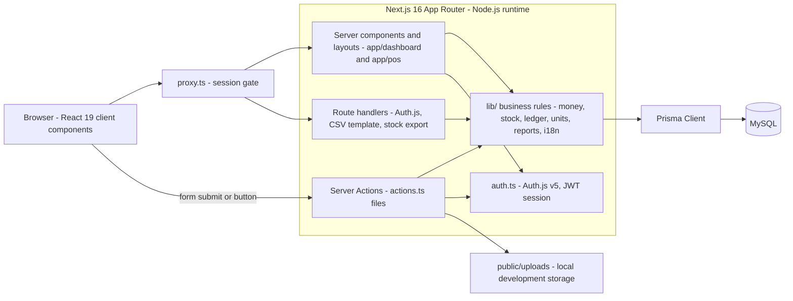
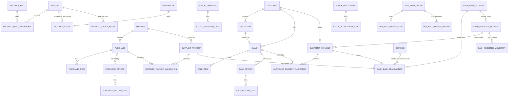
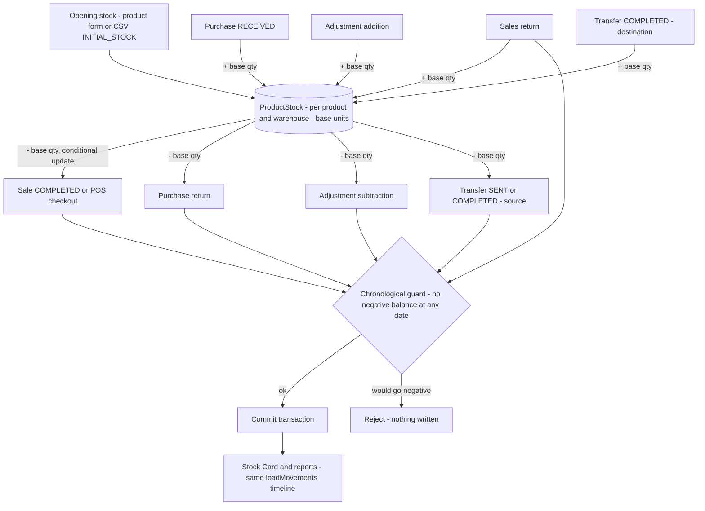
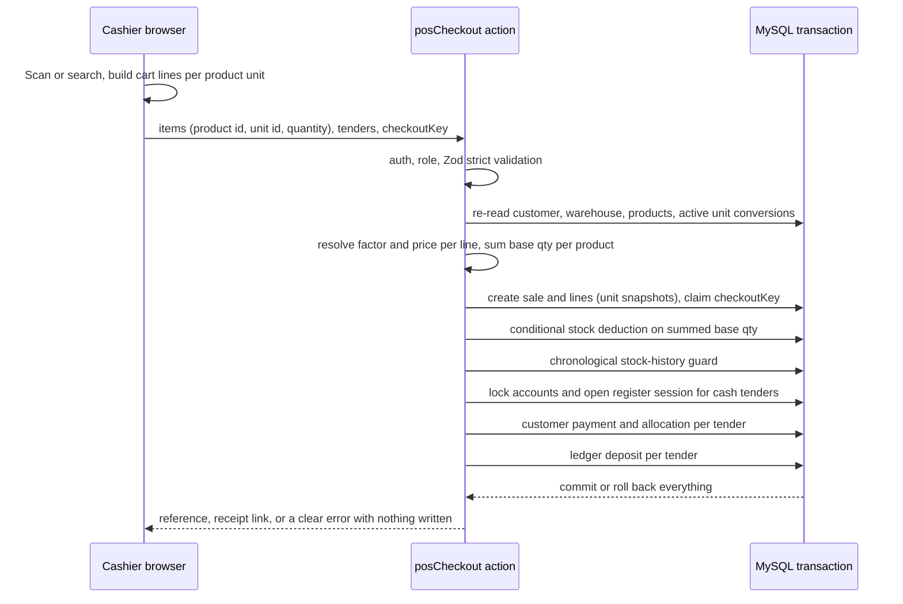
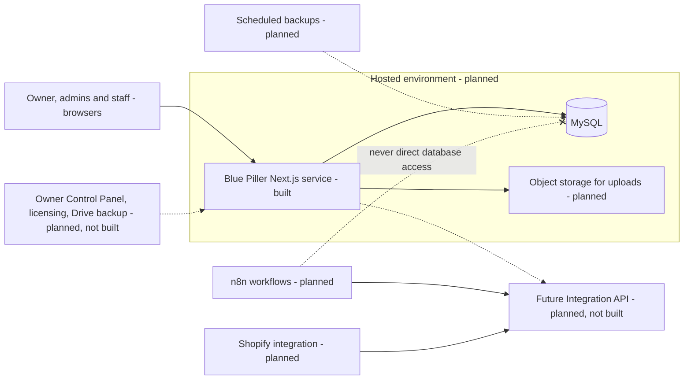

# Blue Piller — Project Documentation (English)

> Living technical and product document. Last verified against commit `ed94d0b` (2026-11-22), package version `0.1.0`, 40 Prisma migrations (latest `20261203000000_pos_multi_unit_lines`).
> Arabic edition: [PROJECT_DOCUMENTATION_AR.md](PROJECT_DOCUMENTATION_AR.md) · Index: [README.md](README.md)
>
> Everything below describes what the code does **today**. Items marked **Planned** or **Deferred** are not implemented.

## Contents

1. [Project Overview](#sec-overview)
2. [Architecture](#sec-architecture)
3. [Authentication and Authorization](#sec-auth)
4. [Application Modules](#sec-modules)
5. [Data Model](#sec-data-model)
6. [Inventory Rules](#sec-inventory)
7. [Financial Rules](#sec-finance)
8. [POS Workflow](#sec-pos)
9. [Reports and Printing](#sec-reports)
10. [Localization](#sec-i18n)
11. [Database and Migration Operations](#sec-db-ops)
12. [Deployment and Production Readiness](#sec-deployment)
13. [Git and Change Workflow](#sec-git)
14. [Roadmap](#sec-roadmap)
15. [Decision Log](#sec-decisions)
16. [How to Maintain This Documentation](#sec-maintenance)

---

<a id="sec-overview"></a>
## 1. Project Overview

**Blue Piller** (`blue_piller`, brand name "Bluepiller") is a web-based inventory management and point-of-sale (POS) system for small and mid-size trading businesses. It covers products and stock, purchasing, sales, quotations, returns, supplier and customer payments, cash and bank accounts, expenses, a cashier POS with register sessions, inventory reports and printable barcode labels. The interface is available in English and Arabic (right-to-left).

**Target users**

| Role | Typical person | Summary |
|---|---|---|
| `OWNER` | Business owner | Everything, including Users, System Settings, Theme, Languages and denominations. |
| `ADMIN` | Manager / accountant / cashier supervisor | All operational modules (purchasing, sales, finance, POS, inventory, barcode printing). No Users or Settings. |
| `USER` | Staff with read access | Read-only access to master data, transfers and adjustments; no money, cost, sales or purchase screens. |

**Technology stack** (from `package.json`)

| Layer | Technology |
|---|---|
| Framework | Next.js `16.4.6` (App Router, Turbopack, `cacheComponents` and `partialPrefetching` enabled), React `19.3.0`, TypeScript 5 |
| Authentication | Auth.js / `next-auth` `5.0.0-beta.32`, Credentials provider, JWT sessions, `bcryptjs` |
| Database | MySQL through Prisma `6.19` (`provider = "mysql"`, client generated into `app/generated/prisma`) and `mysql2` |
| Validation | `zod` 4 (client and server share schemas) |
| Other libraries | `csv-parse` (product import), `react-hot-toast`, `lucide-react` (icons). `formidable`, `pdf-parse` and `uuid` are declared in `package.json` but are not imported by application code at this commit. |
| Styling | One global stylesheet `app/styles.css` (design-system classes `sp-*` and shell classes `bp-*`) plus token files `colors.css`, `typography.css`, `spacing.css`. Tailwind 4 is installed for the CSS pipeline but the application does not use utility classes. |
| Visual source of truth | `design/*.html` (about 80 static mock-ups) |

**Implementation status (at the documented commit)**

- Implemented: authentication and roles, system settings, theme, preferences, English/Arabic localization with owner-managed Arabic overrides, users, profile/PIN, currencies, warehouses, product master data, unit conversions, product CSV import, warehouse stock CSV export, transfers, adjustments, suppliers, customers, purchases, purchase returns, supplier payments, quotations, sales, sales returns, customer payments, cash & bank ledger, expenses, POS (held orders, split payments, walk-in customer, register sessions, cash in/out, denomination counts, lock screen/PIN), inventory reports, supplier/customer statements, barcode printing and a multi-unit POS cart.
- Placeholders only (sidebar entries or demo content without a real implementation): the **Dashboard figures** (the page uses the design's demo data), **Profit & Loss**, **Cash Flow**, **Receivables & Payables Aging**, **Roles/Permissions**, **Reports** (index), **Email Templates** and **SMS Templates**. These sidebar links have no route yet. See [Roadmap](#sec-roadmap).
- There is **no automated test suite in the repository** at this commit. Verification so far was done with scripts run against throwaway databases (not committed). Type-check (`npx tsc --noEmit`), lint (`npm run lint`) and the production build (`npm run build`) are the repository-level checks.

---

<a id="sec-architecture"></a>
## 2. Architecture

### 2.1 Building blocks

- **Next.js 16 App Router.** Pages live under `app/`. Two route trees exist: `app/(dashboard)/…` (the dashboard shell: sidebar, topbar, footer) and `app/pos/…` (a full-screen POS layout without the shell). `app/page.tsx` is the sign-in page at `/`.
- **Server Components** read data directly with Prisma (`lib/db.ts`) and check the session and role before reading anything sensitive. Most list/detail pages call `await connection()` so they are rendered per request.
- **Client Components** (`"use client"`) handle forms, the POS screen and interactive tables. They never contain business rules that the server relies on.
- **Server Actions** (`app/**/actions.ts`) are the write path. Every action re-reads the session with `auth()`, re-checks the role, validates the payload with Zod (`.strict()` — unknown keys are rejected), re-reads all referenced records, recalculates all money and stock effects and writes inside a database transaction.
- **Route handlers** exist only where a file or protocol response is needed: Auth.js (`app/api/auth/[...nextauth]`), the product CSV template (`/products/import/template`) and the warehouse stock export (`/warehouse/[id]/export`).
- **`proxy.ts`** (Next.js 16 replacement of `middleware.ts`) is the first gate: any request without a session is redirected to `/` (public: `/`, `/api/auth/*`, static assets).
- **Business rules live in `lib/`** (exact decimal math, stock deduction, the cash/bank ledger, unit conversion, chronological guards, reports, i18n). Server Actions and pages import them so that every entry point (Sales, POS, imports) shares one implementation.
- **Global styles and shell.** The root layout imports `app/styles.css` once. The dashboard shell (`components/layout/`) provides `Sidebar`, `Topbar` and `Footer`; navigation is declared in `components/layout/nav.ts` and filtered by role. The Owner's theme and each user's personal theme are injected as CSS variables.

> `AGENTS.md` warns that this Next.js version differs from older releases. Read the relevant guide in `node_modules/next/dist/docs/` before changing framework-level code.

### 2.2 System architecture diagram



### 2.3 Request pattern

1. `proxy.ts` rejects anonymous requests.
2. The dashboard layout (`app/(dashboard)/layout.tsx`) calls `auth()` again and redirects to `/` if there is no user.
3. Each page checks its role helper from `lib/roles.ts` (for example `canManagePurchases`) and redirects **before** loading data.
4. Writes go through a Server Action that repeats the role check and validates everything again.
5. The database enforces what it can (unique keys, `RESTRICT` foreign keys, CHECK constraints).

---

<a id="sec-auth"></a>
## 3. Authentication and Authorization

### 3.1 Roles

`enum Role { OWNER ADMIN USER }` (default for new users: `USER`). There is one primary `OWNER`, created by the seed script (`npx prisma db seed`, reads `SEED_ADMIN_*` variables). `OWNER` can never be assigned in the Users screen, cannot be edited into another role and cannot be deleted. Self-registration does not exist.

### 3.2 Protection layers

| # | Layer | What it does |
|---|---|---|
| 1 | `proxy.ts` | Redirects any request without a valid session to `/`. |
| 2 | Dashboard / POS layouts and pages | `auth()` plus a role helper (`lib/roles.ts`); unauthorized roles are redirected before data is read. |
| 3 | Sidebar filtering | `visibleNav(role)` hides entries a role cannot use. This is a convenience only. |
| 4 | Server Actions and route handlers | `auth()` re-read on every call, role re-checked, payload validated with Zod `.strict()`. The role, user id and prices are never taken from the browser. |
| 5 | Database | Unique indexes, `RESTRICT` relations, append-only tables by convention, CHECK constraints (e.g. barcode format). |

### 3.3 Sessions and invalidation

- Strategy: **JWT** (`session: { strategy: "jwt" }`), sign-in page `/`, Credentials provider (email + password, bcrypt hash compare).
- On **every** session read (proxy, layouts, pages, Server Actions) the `jwt` callback re-reads the user from MySQL: a deleted account ends the session immediately; the role, name, email and avatar always reflect the database.
- `User.sessionVersion` is bumped when a password is changed or reset. A token carrying an older version is rejected on its next request. The session that performed a self-service password change is kept alive through a one-time server-side grant (`lib/session-upgrade.ts`); a browser cannot forge it.
- Passwords: at least 8 characters, hashed with `bcryptjs` (cost 12). Hashes and PIN hashes are never sent to the browser.
- POS lock screen is an **interface lock only** (see [POS Workflow](#sec-pos)); it does not touch the Auth.js session.

### 3.4 Permissions matrix

`R` = read-only, `M` = manage (create/edit as the module allows), `—` = no access (redirected, no data returned). Sources: `lib/roles.ts`, page guards and `nav.ts`.

| Area | OWNER | ADMIN | USER |
|---|:-:|:-:|:-:|
| Dashboard (demo figures), Profile, Change Password, personal Preferences/language | M | M | M |
| Products, Categories, Brands, Units, Base Units, Warehouses, Currencies (lists) | M | M | R |
| Suppliers, Customers (lists) | M | M | R |
| Transfers, Adjustments (lists/details; costs hidden from USER) | M | M | R |
| Product create/edit, CSV import, warehouse stock export, Print Barcode | M | M | — |
| Purchases, Purchase Returns, Supplier Payments, Supplier Statement | M | M | — |
| Quotations, Sales, Sales Returns, Customer Payments, Customer Statement | M | M | — |
| Cash & Bank accounts/transactions, Expenses, Expense Categories | M | M | — |
| Inventory Reports (and their report pages) | R | R | — |
| POS, held orders, registers, receipts, register-session report | M | M | — |
| POS Cashier PIN (set on Profile) | M | M | — |
| Users | M | — | — |
| System Settings, Theme (global), Cash Denominations, Languages (translation overrides), Walk-in customer setting | M | — | — |

---

<a id="sec-modules"></a>
## 4. Application Modules

Reference numbers are generated on the server from MySQL `AUTO_INCREMENT` counters and are never reused: `SA_` sales, `PU_` purchases, `PR_` purchase returns, `SR_` sales returns, `QU_` quotations, `TR_` transfers, `AD_` adjustments, `SP_` supplier payments, `CP_` customer payments, `EX_` expenses, `HO_` held POS orders, `RS_` register sessions, `RM_` register movements, and `DEP_` / `WDR_` / `TRF_` for ledger rows.

### 4.1 Settings, appearance and language

| Module | Route(s) | Roles | Purpose and key rules |
|---|---|---|---|
| System Settings | `/settings` | OWNER | Singleton row `SystemSettings` (id 1): company name/logo/contact, default currency, country/state/city, date format, footer text, optional POS Walk-in customer. Logo upload is local-development storage. |
| Theme (global) | `/settings/theme` | OWNER | Validated theme JSON stored in `SystemSettings.theme`, rendered as CSS variables on the server. |
| Preferences | `/preferences` | all roles | Per-user theme and language in `UserPreference`; takes precedence over the global theme for that user only. |
| Languages / Translation Management | `/settings/languages` | OWNER | Edit the **Arabic** text of any catalog key (`TranslationOverride`); English is never stored. See [Localization](#sec-i18n). |
| Cash Denominations | `/settings/denominations` | OWNER | Banknote/coin values per currency used to count the drawer when closing a register. A denomination used by a closed count is inactivated, never deleted. |

### 4.2 Users, profile and security

| Module | Route(s) | Roles | Purpose and key rules |
|---|---|---|---|
| Users | `/users`, `/users/create`, `/users/[id]/edit` | OWNER | Create/edit/delete `ADMIN` and `USER` accounts. Deletion is refused when the user authored business records. Avatar: JPG/PNG/WebP, 2 MB. |
| Profile | `/profile` | all roles | Own name/contact/avatar. The Cashier PIN section is available to `OWNER` and `ADMIN`. |
| Change Password | `/change-password` | all roles | Bumps `sessionVersion`; other sessions end; the current session stays. |
| POS Cashier PIN | on `/profile` | OWNER, ADMIN | Optional PIN (bcrypt hash in `users.posPinHash`) that only unlocks the POS lock screen. Weak PINs (all equal, ascending/descending runs) are refused. It is never a login. |

### 4.3 Master data and products

| Module | Route(s) | Roles | Purpose and key rules |
|---|---|---|---|
| Currencies | `/currencies` | view: all · manage: OWNER, ADMIN | 3-letter unique code. The **System Settings default currency** is used for all documents; there is no multi-currency conversion. |
| Warehouses | `/warehouse`, `/warehouse/create`, `/warehouse/[id]/edit` | view: all · manage: OWNER, ADMIN | Unique name; deletion refused while stock or documents reference it. |
| Categories / Brands / Units | `/products/categories`, `/products/brands`, `/products/units` | view: all · manage: OWNER, ADMIN | Unique names. A Unit is only a reusable **label** (Piece, Box…); the factor belongs to each product. Deletion is refused while referenced, including when used as a product's pack unit. |
| Products | `/products`, `/products/create`, `/products/[id]/edit` | view: all · create/edit: OWNER, ADMIN | Unique uppercase `code`; cost/price `DECIMAL(14,2)`; quantities `DECIMAL(14,3)`; tax rate and type (`EXCLUSIVE`/`INCLUSIVE`); stock alert; up to 5 images (JPG/PNG/WebP, 2 MB each). Create records an opening-stock entry (supplier, warehouse, quantity, status; only `RECEIVED` changes stock). **Products cannot be deleted** (no delete action exists). |
| Base Units / Product Units | `/base-units` (view) and the *Product Units* section of the product form | view: all · edit: OWNER, ADMIN | See [Inventory Rules](#sec-inventory). One base unit per product, additional units with a positive factor, Sales/Purchases purpose, active flag, one barcode per unit. |
| CSV Product Import | modal on `/products`; template `/products/import/template` | OWNER, ADMIN | Create-only, preview then confirm in one transaction; max 1000 rows and 5 MB; the `Unit` column becomes the product's **base unit**; `Opening Stock` is recorded as `INITIAL_STOCK` (no supplier, no purchase, no payable, no ledger entry); the Product Code becomes the base-unit barcode when valid. Existing products are never changed. |
| Warehouse Stock Export | `/warehouse/[id]/export` (CSV) | OWNER, ADMIN | Stock per product for one warehouse; headings say *Base Unit* and *In Stock (base unit)*. |
| Print Barcode | `/print-barcode`, `/print-barcode/labels` | OWNER, ADMIN | See [Reports and Printing](#sec-reports). |

### 4.4 Inventory operations

| Module | Route(s) | Roles | Purpose and key rules |
|---|---|---|---|
| Transfers | `/transfers`, `/transfers/create`, `/transfers/[id]`, `/transfers/[id]/edit` | view: all · manage: OWNER, ADMIN | Between two warehouses. Status `PENDING` (no stock effect) → `SENT` (deducts source) → `COMPLETED` (deducts source if not already, adds destination). `SENT`/`COMPLETED` are history and never deleted; `COMPLETED` is immutable. Lines snapshot unit, factor and base quantity. |
| Adjustments | `/adjustments`, `/adjustments/create`, `/adjustments/[id]/edit` | view: all · manage: OWNER, ADMIN | Manual additions/subtractions per warehouse. Create/edit/delete apply or reverse the net effect in one transaction; stock cannot go below zero and history cannot become negative. |

### 4.5 Purchasing and suppliers

| Module | Route(s) | Roles | Purpose and key rules |
|---|---|---|---|
| Suppliers | `/suppliers`, `/suppliers/create`, `/suppliers/[id]/edit` | view: all · manage: OWNER, ADMIN | Unique name; deletion refused while referenced. |
| Purchases | `/purchases`, `/purchases/create`, `/purchases/[id]` | OWNER, ADMIN | Totals recomputed on the server (half-up to the cent) and stored as a snapshot. Status `RECEIVED` / `PENDING` / `ORDERED`; stock is added once, when `RECEIVED` (on creation or via *Mark as Received*). Lines carry unit snapshots. Purchases are immutable after creation (no edit/delete). |
| Purchase Returns | `/purchases/returns`, `/purchases/returns/create`, `/purchases/returns/[id]` | OWNER, ADMIN | Only from a `RECEIVED` purchase; quantity ≤ purchased − already returned (in the original line's unit and in base units); stock is deducted with a conditional update; amounts are prorated from the purchase snapshot; reduces the purchase's Due. Immutable. No refund/credit workflow. |
| Supplier Payments | `/supplier-payments`, `/supplier-payments/record` | OWNER, ADMIN | See [Financial Rules](#sec-finance). |
| Supplier Statement | `/suppliers/statement` → report `/reports/supplier-statement` | OWNER, ADMIN | Purchases, returns, payments and balances of one supplier (print-friendly report). |

### 4.6 Sales and customers

| Module | Route(s) | Roles | Purpose and key rules |
|---|---|---|---|
| Customers | `/customers`, `/customers/create`, `/customers/[id]/edit` | view: all · manage: OWNER, ADMIN | Unique name; deletion refused while referenced (including as the POS walk-in customer). |
| Quotations | `/quotations`, `/quotations/create`, `/quotations/[id]`, `/quotations/[id]/edit` | OWNER, ADMIN | Commercial offer only: no stock, ledger or balance effect. Lifecycle `DRAFT → SENT → ACCEPTED \| REJECTED \| EXPIRED`; only `DRAFT` is editable/deletable. Quotation lines are in each product's **base unit** only (pack units are rejected on the server). An `ACCEPTED` quotation converts once into a `PENDING` sale. |
| Sales | `/sales`, `/sales/create`, `/sales/[id]`, `/sales/[id]/edit` | OWNER, ADMIN | `PENDING` or `COMPLETED`. Stock is deducted when a sale becomes `COMPLETED` (conditional update, all-or-nothing). Only `PENDING` sales can be edited or deleted. A line's unit, factor and base quantity are snapshotted server-side. Payments are recorded separately (Customer Payments) and tracked in `Sale.paidAmount`. |
| Sales Returns | `/sales/returns`, `/sales/returns/create`, `/sales/returns/[id]` | OWNER, ADMIN | Only `COMPLETED` sales; quantity ≤ sold − returned (per line, in the line's unit); stock returns to the sale's warehouse; the return amount cannot exceed the sale's unpaid Due. Immutable. **Refunds and customer credit for paid amounts are not built** — consequently a fully paid sale (including every POS sale) cannot be returned yet. |
| Customer Payments | `/customer-payments`, `/customer-payments/record` | OWNER, ADMIN | See [Financial Rules](#sec-finance). |
| Customer Statement | `/customers/statement` → report `/reports/customer-statement` | OWNER, ADMIN | Sales, returns, payments and balances of one customer. |

### 4.7 Finance

The sidebar group *Finance* contains only the modules below. *Profit & Loss*, *Cash Flow* and *Receivables & Payables Aging* are **sidebar placeholders without routes** (planned).

| Module | Route(s) | Roles | Purpose and key rules |
|---|---|---|---|
| Cash & Bank Accounts | `/finance/accounts` | OWNER, ADMIN | Accounts of type `CASH` or `BANK`, `ACTIVE`/`INACTIVE`. Opening balance set once; **no stored balance** (computed from the ledger). Accounts are deactivated, never deleted. An account with an open register cannot be deactivated or turned into a bank account. |
| Cash & Bank Transactions | `/finance/transactions` | OWNER, ADMIN | Manual deposit, withdrawal and internal transfer on the append-only ledger. |
| Expenses | `/expenses`, `/expenses/create`, `/expenses/[id]/edit` | OWNER, ADMIN | Each expense is paid from an account (ledger `WITHDRAWAL`). Edits append a reversal `DEPOSIT` plus a new `WITHDRAWAL`; delete is a soft delete (`deletedAt`) with a reversal. |
| Expense Categories | `/expenses/categories` | OWNER, ADMIN | Unique names; deletion refused while referenced. |

### 4.8 Point of Sale

| Module | Route(s) | Roles | Purpose and key rules |
|---|---|---|---|
| POS | `/pos` (full-screen) | OWNER, ADMIN | Details in [POS Workflow](#sec-pos). Checkout, held orders, split payments (up to 5 tenders), walk-in customer, register sessions, cash in/out, denomination counting, lock screen. |
| Receipt | `/reports/pos-receipt/[saleId]` | OWNER, ADMIN | Printable POS receipt with every tender. |
| Register Session Report | `/reports/register-session/[sessionId]` | OWNER, ADMIN | Printable shift report (opening, tenders, cash in/out, expected vs counted cash). |

### 4.9 Barcode printing and multi-unit POS cart

- **Barcodes** belong to a *product unit* (one nullable, globally unique barcode per unit row). They are managed in the product form (OWNER/ADMIN). Format and uniqueness rules are in [Inventory Rules](#sec-inventory).
- **Print Barcode** (`/print-barcode`): choose products and units, label counts, paper (A4 or US Letter) and layout, then *View Labels* opens `/print-barcode/labels`, the only place with a **Print Barcode** button. Read-only.
- **Multi-unit POS cart:** a cart line is a *product unit*. Water × 1 Box and Water × 2 Piece are two lines; scanning a barcode adds one of that exact unit; stock is checked against the **sum** of all lines of a product.

### 4.10 Inventory Reports

| Report | Parameter page | Report route | Roles |
|---|---|---|---|
| Stock Balance by Warehouse | `/inventory-reports/stock-balance` | `/reports/stock-balance` | OWNER, ADMIN |
| Product Movement (Stock Card) | `/inventory-reports/product-movement` | `/reports/product-movement` | OWNER, ADMIN |
| Low Stock Items | `/inventory-reports/low-stock` | `/reports/low-stock` | OWNER, ADMIN |

Reports are read-only, in base units, and open from *View Report* into a print-friendly page.

---

<a id="sec-data-model"></a>
## 5. Data Model

The schema has **45 models and 19 enums** (`prisma/schema.prisma`). Conventions: primary keys are `cuid()`; money is `DECIMAL(14,2)`, quantities `DECIMAL(14,3)`, unit factors `DECIMAL(16,6)` — never floating point; master-data relations are `RESTRICT` so referenced records cannot be deleted; documents keep their own **snapshots** (code, name, unit, price, tax) so later master-data edits never rewrite history.

### 5.1 Core entity relationships



### 5.2 Entity groups

| Group | Models | Notes |
|---|---|---|
| Identity & settings | `User`, `UserPreference`, `SystemSettings`, `TranslationOverride`, `Currency`, `CurrencyDenomination` | `SystemSettings` is a singleton (id 1). `User.sessionVersion` and `posPinHash` support session invalidation and the POS PIN. |
| Master data | `Warehouse`, `ProductCategory`, `Brand`, `ProductUnit`, `Supplier`, `Customer`, `ExpenseCategory` | Unique names (case-insensitive collation); `RESTRICT` deletes. |
| Products | `Product`, `ProductImage`, `ProductUnitConversion` | `ProductUnitConversion` = per-product unit: `factor`, `isBase`, `active`, `forSales`, `forPurchases`, nullable unique `barcode`. |
| Stock | `ProductStock`, `ProductStockEntry`, `StockTransfer(+Item)`, `StockAdjustment(+Item)` | `ProductStock` is the persisted on-hand quantity per product + warehouse. |
| Purchasing | `Purchase(+Item)`, `PurchaseReturn(+Item)`, `SupplierPayment`, `SupplierPaymentAllocation` | |
| Selling | `Quotation(+Item)`, `Sale(+Item)`, `SaleReturn(+Item)`, `CustomerPayment`, `CustomerPaymentAllocation` | `Sale.posCheckoutKey` (unique) makes POS checkout idempotent; `Sale.quotationId` is unique (one conversion). |
| Finance | `CashBankAccount`, `CashBankTransaction`, `Expense` | Ledger rows link to the document that produced them (`supplierPaymentId`, `customerPaymentId`, `expenseId`). |
| POS | `PosHeldOrder`, `PosHeldOrderItem`, `PosHeldOrderTender`, `CashRegisterSession`, `CashRegisterMovement`, `CashRegisterCount` | `openAccountKey` (unique) guarantees one open session per account. |

### 5.3 Persistence by concern

**Stock.** The current quantity is stored in `ProductStock` (per product + warehouse, base units). It is changed only inside transactions with conditional updates. History is the set of immutable documents (opening-stock entries, purchase/return/sale/return/transfer/adjustment lines); the Stock Card derives the movement timeline from them.

**Money.** There is **no stored account balance**. The balance of a `CashBankAccount` is `openingBalance + deposits − withdrawals − transfers out + transfers in`, computed from append-only `CashBankTransaction` rows. Document totals (`subtotal`, taxes, discounts, `grandTotal`) are server-computed snapshots; the amount paid is stored on the document (`Sale.paidAmount`, `Purchase.paidAmount`) and moved only by payment allocations.

**Document history.** Documents and their lines are snapshots. Lines never copy a barcode, so changing a barcode cannot rewrite history. Lines of purchases, returns, sales, transfers and adjustments carry `unitId` (nullable = legacy factor 1), `unitName`, `unitFactor`, entered `quantity` and `baseQuantity` (the stock effect).

---

<a id="sec-inventory"></a>
## 6. Inventory Rules

### 6.1 Base units and conversions

- Every product has exactly **one base unit** (`Product.productUnitId`, conversion row with `isBase = true` and factor 1). **All stock is stored, checked and reported in base units.**
- Additional units (Box, Carton…) are rows of `ProductUnitConversion` with a strictly positive `factor` (base units in one pack, up to 6 decimals), unique per product + unit, an `active` flag and a purpose (Sales, Purchases or both). Default sale/purchase units must be active units enabled for that purpose.
- **Exact arithmetic:** entered quantity × factor is computed with integers (`lib/unit-math.ts`). The result must be exact within 3 decimals; otherwise the line is **rejected, never rounded**. Default unit price = product base price × factor (half-up to the cent); price lists and package discounts do not exist.
- **Server-authoritative:** the browser sends only a unit id as a selector. The server resolves factor, base quantity and price from the product's own active conversions. Forged units, factors, base quantities or prices are rejected.
- **Safety rules:** the base unit cannot change once a product has stock, history or documents. A conversion used by any document keeps its factor and can only be deactivated. Units referenced by products cannot be deleted. Deactivating a unit hides it from new documents and POS/labels but keeps history.
- **Migration behaviour:** existing products received a factor-1 base mapping from their unit; historical lines were treated as factor 1 (`baseQuantity = quantity`, `unitId = NULL`).

### 6.2 Barcodes (per product unit)

- One nullable barcode per unit row; unique across **all products** (case-insensitive unique index).
- Normalization: trimmed; Code 128 subset B printable ASCII only (`0x20`–`0x7E`); 1–20 characters; case preserved. A database CHECK enforces the same.
- A barcode may not equal another product's **Product Code** (so scans and code search never collide). Inactive units keep their barcode reserved.
- The Base Unit barcode defaults to the Product Code when that code is valid and free (product form blank value, CSV import, migration backfill). Otherwise the unit has no barcode and cannot be printed or scanned.
- Product Code (SKU) and barcode are different identifiers that merely start equal for the base unit.

### 6.3 Stock effects by document

| Document | Stock effect (base units) |
|---|---|
| Product create (form) | `ProductStockEntry` source `PRODUCT_FORM` (needs a supplier, as recorded); on-hand increases only when its status is `RECEIVED`. |
| CSV import | `ProductStockEntry` source `INITIAL_STOCK`: no supplier, purchase, payable or ledger entry. |
| Purchase | `RECEIVED` adds once; `PENDING`/`ORDERED` change nothing until marked received. |
| Purchase return | Deducts (conditional, never below zero). |
| Sale / POS sale | Deducts when `COMPLETED` (POS: always at checkout). All lines of one product are summed before the availability check. |
| Sales return | Adds back to the sale's warehouse. |
| Transfer | `SENT` deducts source; `COMPLETED` adds destination (and deducts source if not yet sent). |
| Adjustment | `ADDITION` adds, `SUBTRACTION` deducts; edits/deletes reverse the net effect. |
| Quotation / held POS order | None. |

### 6.4 Stock history and the chronological guard

Current-stock checks only prove stock is non-negative **now**. A document dated in the past (a return, transfer or adjustment) also changes every later balance. `lib/stock-history-guard.ts` rebuilds the affected product + warehouse timeline inside the writing transaction and rejects the operation if any balance from the changed point onward would be negative. It re-locks the stock rows, runs under `READ COMMITTED` and uses the same `loadMovements` function as the Stock Card, so the report and the guard always agree. Stock that exists without recorded movements is treated as an opening balance at the beginning of time (never invented as a movement).

### 6.5 Stock movement workflow



---

<a id="sec-finance"></a>
## 7. Financial Rules

- **Append-only ledger.** `CashBankTransaction` rows (`DEPOSIT`, `WITHDRAWAL`, `TRANSFER`) are never edited or deleted. Corrections are new rows (for example an expense edit appends a reversal deposit and a new withdrawal).
- **No stored balance.** An account's balance is recomputed from committed ledger rows while the account rows are locked (`SELECT … FOR UPDATE`, id order, no deadlocks).
- **Overdraft and backdating.** Money out needs enough *current* balance and must not make the *chronological* running balance negative at any date (`lib/cash-bank-ledger.ts`, shared by Cash & Bank, Expenses and supplier payments). Money in (customer receipts) cannot cause a negative balance and needs no such check.
- **Currency.** Accounts must be active and in the document currency; the default currency from System Settings is used for new documents.
- **Supplier payments** (`/supplier-payments/record`): immutable; each payment is allocated **in full** to one or more of that supplier's purchases (amount = Σ allocations). Each allocation must be > 0 and ≤ the purchase's Due = `Grand Total − Paid − completed returns`, re-read under row locks. The payment date cannot precede the purchase date. It increments `Purchase.paidAmount` and appends exactly one ledger `WITHDRAWAL`.
- **Customer payments** (`/customer-payments/record`): immutable; allocated in full to the customer's `COMPLETED` sales, each ≤ the sale's Due = `max(0, Grand Total − completed returns − Paid)`. It increments `Sale.paidAmount` and appends exactly one ledger `DEPOSIT`.
- **POS** writes a sale, one customer payment per tender (allocated to that sale) and one ledger deposit per tender in the same transaction.
- **Registers** (cash-drawer shifts) are not an accounting system: opening/closing writes no ledger row; Cash In/Out are real balanced internal ledger transfers linked to the session.

**Deliberately not implemented yet:** supplier credit and customer credit/refunds, unallocated receipts or prepayments, refunds of paid sales and purchases, multi-currency conversion, accounting journals/chart of accounts, and the financial reports (*Profit & Loss*, *Cash Flow*, *Aging*).

---

<a id="sec-pos"></a>
## 8. POS Workflow

### 8.1 Flow

1. A cashier (`OWNER`/`ADMIN`) opens `/pos`, chooses a customer (or the configured **Walk-in Customer**) and a warehouse.
2. Products are added by clicking a card, searching by name/code, or **scanning a barcode** (keyboard-style scanner + Enter).
3. The cart builds lines per **product unit**. Prices and totals shown are a preview; the server recomputes everything.
4. *Pay* opens the payment panel: one tender (full total) or a **split payment** of up to 5 tenders (`Cash`, `Bank Transfer`, `Card`, `Cheque`), each with a receiving account in the sale currency. Tenders must add up to the Grand Total exactly (no change, no partial payments).
5. Checkout is **idempotent** (`checkoutKey`): a retried request returns the first result and never repeats effects.
6. Result: one `COMPLETED` sale (+ lines with unit snapshots), stock deduction, one customer payment per tender allocated to the sale, one ledger deposit per tender, and the receipt.

### 8.2 Registers, held orders, lock

- **Register sessions:** one `OPEN` session per cash account (`openAccountKey` unique). Every **Cash** tender must go into a `CASH` account with an open session (the session row is locked, so a checkout cannot attach to a closing session). **Expected Cash = opening cash + Σ POS cash tenders in this session + Σ Cash In − Σ Cash Out**, recomputed on the server at close. Closing stores the counted cash and the difference; with configured denominations, the count is entered per denomination and snapshotted. A closed session is immutable.
- **Cash In / Cash Out:** balanced internal ledger transfers between the register account and a counter-account, dated today (no backdating).
- **Held orders:** a hold saves a draft (lines with resolved unit ids, customer, warehouse, draft tenders, notes) in `PosHeldOrder*`; nothing is reserved and no stock or money moves. Statuses `HELD` → `CONSUMED` (by checkout) or `DISCARDED`. Max 50 open held orders per user; only the creator can list/resume/discard. Resume re-validates every reference. Old held orders without a saved unit resume in the product's default sale unit.
- **Lock screen:** an interface lock that hides the cart and products. Unlock with the account password or the optional Cashier PIN; at most 5 failed attempts per user per minute (best-effort, in-memory per server process). It never touches the Auth.js session.

### 8.3 Barcode scan and multi-unit cart

- An exact match of a unit barcode (case-insensitive) adds **one** of that product unit (base unit, Box, Carton…) using its factor. Same-unit scans merge into one line; another unit of the same product becomes a separate line.
- A scan of an inactive, unknown or purchase-only (not enabled for sales) unit adds nothing and shows a message. Product-name and Product-Code search still work; a typed value equal to the base barcode adds the base unit.
- The on-screen stock limit counts **all** lines of a product. At checkout the server sums the base quantity of every line per product + warehouse **before** validating stock, so mixed-unit lines cannot oversell. Duplicate (product, unit) lines, inactive/unknown units and forged factor/base quantity/price fields are rejected.
- `sale_items` and `pos_held_order_items` are unique on (document, product, unit).

### 8.4 POS sequence diagram



---

<a id="sec-reports"></a>
## 9. Reports and Printing

### 9.1 The *View Report → Print Report* convention

- Reports are opened from a parameter page with **View** (Inventory Reports, statements) into a separate print-friendly route under `/reports/…`.
- Only report/preview pages have a **Print** button: the shared `components/reports/ReportActions.tsx` is the **only** place in the code that calls `window.print()` (the POS receipt, register report, statements, inventory reports and barcode labels all use it). Parameter, selection and list pages never print directly.
- Printing is CSS-driven: the shell (`sidebar`, `topbar`, `footer`) and toolbar are hidden with `@media print`; reports are document-styled (company header, generated date/user).

### 9.2 Implemented reports

| Report | Route | Notes |
|---|---|---|
| Stock Balance by Warehouse | `/reports/stock-balance` | Persisted stock of one warehouse, status IN/LOW/OUT, base units. |
| Product Movement (Stock Card) | `/reports/product-movement` | Chronological ledger with running balance; reconciles with stored stock and shows any unexplained variance. |
| Low Stock Items | `/reports/low-stock` | Products with a positive stock alert whose stock is at or below it (alert 0 never counts as low; "out" means nothing on hand). |
| Supplier Statement | `/reports/supplier-statement` | OWNER/ADMIN. |
| Customer Statement | `/reports/customer-statement` | OWNER/ADMIN. |
| POS Receipt | `/reports/pos-receipt/[saleId]` | Lists every tender. |
| Register Session | `/reports/register-session/[sessionId]` | Shift summary and cash count. |

**Inventory report reconciliation:** the Stock Card derives movements from saved documents (`loadMovements`) and compares the closing balance with `ProductStock`; a non-zero difference is shown as *variance*. The chronological guard uses the same function.

### 9.3 Barcode label printing

- Flow: `/print-barcode` (select) → **View Labels** → `/print-barcode/labels` (preview) → **Print Barcode**.
- Labels are server-rendered inline-SVG **Code 128** (subset B), no external service, font or script. Barcode text, price and codes stay left-to-right on Arabic pages; the sheet geometry never mirrors.
- A label shows company name, product name, selected unit, barcode text and (optionally) a price. The price is shown only for a unit that can be sold (base unit or enabled for sales) = product price × unit factor (no price lists).
- Limits (server-enforced): 50 units and 500 labels per batch; read-only (no business data is written).
- **Paper and layouts** (user chooses paper first; geometry is defined per paper in millimetres and passed to CSS as variables; `@page` size is set per paper):

| Paper | Layout | Label (mm) | Grid |
|---|---|---|---|
| US Letter (215.9 × 279.4) | 30 per sheet | 66.7 × 25.4 | 3 × 10 |
| US Letter | 20 per sheet | 101.6 × 25.4 | 2 × 10 |
| US Letter | 14 per sheet | 101.6 × 33.8 | 2 × 7 |
| US Letter | 10 per sheet | 101.6 × 50.8 | 2 × 5 |
| A4 (210 × 297) | 24 per sheet | 70 × 37 | 3 × 8 |
| A4 | 16 per sheet | 99.1 × 33.9 | 2 × 8 |
| A4 | 14 per sheet | 99.1 × 38.1 | 2 × 7 |
| A4 | 10 per sheet | 99.1 × 57 | 2 × 5 |

- **Limitations / real-printer note:** layouts follow common Avery-style label sheets but have been verified only against generated PDFs and on-screen geometry, **not on a physical printer**. Print at 100% scale with margins set to *None*. Printing uses the browser dialog; there is no printer discovery, thermal-roll format, silent printing or scanner configuration. Always test one real sheet on your stock before a large batch. Only Code 128 is supported (no EAN/UPC generation).

---

<a id="sec-i18n"></a>
## 10. Localization

- **Locales:** `en` and `ar`. English is the source of truth in code; Arabic is the default translation in code plus optional database overrides.
- **Locale precedence:** the signed-in user's saved language (`UserPreference.locale`) → the `bp-locale` cookie (signed-out pages such as sign-in) → English. No locale-prefixed routes; `proxy.ts` is not involved.
- **Dictionaries:** typed objects in `lib/i18n/dictionaries/` (`en.ts` assembles `en-*.ts` files; `ar.ts` assembles `ar-*.ts`). The Arabic dictionaries are typed against the English shape, so a missing key is a compile error. `getDict()` (server) and `useT()` (client) return the effective dictionary; `fmt()` interpolates `{placeholder}` values; server messages are returned as dictionary **keys** plus variables and translated per request (`LocalizedError`, `tr()`).
- **Overrides:** the Owner edits Arabic text in `/settings/languages`. Rows in `TranslationOverride` replace the default Arabic for **signed-in Arabic requests only**, only for keys that exist in the server catalog (`lib/i18n/catalog.ts`) and with the **same placeholders**. English is never stored; signed-out pages never serve overrides. Saves/resets appear on the next request.
- **Catalog:** `lib/i18n/catalog.ts` derives translatable keys from the dictionaries and groups them into sections. A new top-level dictionary group must be added to a section there or it will not be editable.
- **RTL principles:** `<html dir="rtl">` for Arabic; the layout mirrors through flex/grid; physical left/right rules are corrected in `app/styles.css`. Numbers, codes, emails, references, product codes and barcodes are always wrapped as left-to-right (`<bdi dir="ltr">`). User data (names, units, product names) is never translated. Latin digits are kept for money and references.

**When adding a visible string:** add it to `en-*.ts` **and** `ar-*.ts` with identical placeholders; use `useT()` / `getDict()` (never hard-coded text, including toasts, validation messages, `aria-label`s, `title`s and page titles); add a new group to `catalog.ts` if needed; keep server errors as keys; check the page in Arabic (RTL, 390 px width, no stray English) and keep `<bdi dir="ltr">` around codes.

---

<a id="sec-db-ops"></a>
## 11. Database and Migration Operations

**Safe local commands**

```bash
npm install            # dependencies
npx prisma generate    # regenerate the Prisma client (app/generated/prisma is not committed)
npx prisma migrate deploy   # apply pending migrations (non-destructive for existing data)
npm run dev            # start the development server
```

Also available: `npm run lint`, `npx tsc --noEmit`, `npm run build`, `npm run start`, and `npx prisma db seed` (creates/updates the primary OWNER from `SEED_ADMIN_*` variables; an existing password is preserved unless `SEED_ADMIN_RESET_PASSWORD` is exactly `true`).

**Why migrations must be applied before the matching code runs.** The Prisma client is generated from `schema.prisma`; new code selects and writes columns that exist only after the migration. Running new code on an old database fails at runtime, and running old code on a migrated database may ignore new unique rules. After pulling changes: run `npx prisma migrate deploy`, then `npx prisma generate`, then restart. If `generate` reports a locked engine file on Windows, stop the dev server first.

**Migration safety**

- Migrations are committed with the code that needs them and applied in order. The repository holds 40 (`prisma/migrations`). Read each migration before applying it; data migrations in this project preserve existing rows (e.g. unit conversions add factor-1 mappings and keep every quantity/price/reference).
- Several migrations contain data backfills and CHECK constraints. Test them on a **copy** of real data in a **throwaway database** first, on the same MySQL/MariaDB version as production (CHECK constraints are enforced from MySQL 8.0.16 / MariaDB 10.2.1).
- **QA rule:** automated or exploratory testing must use a separate throwaway database (for example one whose name clearly says it is QA), never the real database, real uploads, users or settings.
- Never run `prisma migrate reset`, `prisma db push --force-reset`, `DROP DATABASE` or manual deletes against a database that holds real data. Take a verified backup before every production migration. This document intentionally lists no destructive commands.
- To inspect state read-only: `npx prisma migrate status`.

---

<a id="sec-deployment"></a>
## 12. Deployment and Production Readiness

### 12.1 Current limitations (local-development state)

- **Uploads are local files.** Avatars, product images, brand/category/unit images and logos are written to `public/uploads/<folder>/` (`lib/image-upload.ts`). A production Next.js server serves only files present at build time and the disk may not persist. **Production requires persistent object storage** (S3-compatible or similar) behind the same helper. `public/uploads` must not be committed.
- **In-memory state per process:** the one-time password-change session grant and the POS unlock rate limiter live in server memory. Run a single instance or use sticky routing until they are moved to shared storage.
- No automated tests, no CI pipeline, no health-check endpoint, no structured logging/monitoring and no backup automation exist in the repository.
- The Dashboard shows design demo data; several sidebar entries have no routes (see [Roadmap](#sec-roadmap)).
- Server Action body limit is 6 MB (`next.config.ts`; images 2 MB, CSV 5 MB).

### 12.2 Environment variables (names only)

| Name | Purpose |
|---|---|
| `DATABASE_URL` | MySQL connection string used by Prisma (required). |
| `AUTH_SECRET` | Auth.js secret used to sign/encrypt session tokens (required in production). |
| `AUTH_TRUST_HOST` | Auth.js host trust flag for reverse proxies/hosting platforms. |
| `AUTH_URL` | Optional Auth.js base URL; verify whether the chosen host needs it. |
| `NEXT_PUBLIC_APP_NAME`, `NEXT_PUBLIC_APP_URL` | Present in the local `.env` template; **not referenced by the current code**. |
| `SEED_ADMIN_FIRST_NAME`, `SEED_ADMIN_LAST_NAME`, `SEED_ADMIN_EMAIL`, `SEED_ADMIN_PASSWORD`, `SEED_ADMIN_PHONE`, `SEED_ADMIN_IMAGE` | Used only by `prisma/seed.ts` to create the primary OWNER. |
| `SEED_ADMIN_RESET_PASSWORD` | Optional; exactly `true` makes the seed replace the owner's password hash. |

`.env` is ignored by git (`/.env*`). Never commit or paste its values.

### 12.3 Hosted-first recommendation (Render)

The recommended direction is a **hosted-first** deployment (for example on Render) rather than a self-installed local server:

- Run the Next.js app as a web service (`npm run build` then `npm run start`), one instance initially.
- **MySQL:** the application targets MySQL through Prisma. Verify the current hosting offer before deciding — if the platform has no managed MySQL, use an external managed MySQL provider (same region, TLS, private networking where possible) or a private service with a persistent disk and your own backups. Test every migration on the exact target version.
- Add S3-compatible object storage for uploads before real use.
- Set the environment variables above in the platform's secret store, never in the repository.

### 12.4 Production checklist

| Area | Items |
|---|---|
| Security | Strong `AUTH_SECRET`; HTTPS only; rotate the seed password after first sign-in and remove `SEED_ADMIN_PASSWORD` from the environment; least-privilege database user; review that no secrets are in git history; keep dependencies updated (`next-auth` is a v5 beta). |
| Data | Daily automated database backups with periodic **restore tests**; migration runbook (backup → `migrate deploy` → verify); separate QA database. |
| Reliability | Health check, uptime monitor, error logging/alerts, connection-pool sizing, single instance (or shared session/limiter state). |
| Storage | Object storage for uploads and a backup of it. |
| Operations | Time zone and date-format decisions (documents use server "today"); printer test on real label stock; Arabic font rendering check on the target browsers. |

### 12.5 Deployment and future integration boundary



The **Owner Control Panel, licensing, Drive backup and the n8n/Shopify Integration API are planned and are not built.** External automation must go through a future authenticated API owned by the application, never directly to the database.

---

<a id="sec-git"></a>
## 13. Git and Change Workflow

1. **Inspect before staging:** run `git status` and `git diff --stat`; read what you are about to commit.
2. **Never commit:** `.env*`, `public/uploads/`, `public/images/` runtime files, `server.log` or other logs, `.vscode/`, scratch scripts, generated client (`app/generated/prisma` is already ignored). Stage files explicitly, not with a blind `git add -A`. (At the documented commit `.vscode/`, `public/uploads/`, `public/images/` and `server.log` are not in `.gitignore`, so they appear as untracked files and must be left out deliberately.)
3. **Migrations travel with the code** that needs them in the same commit (`prisma/migrations/<timestamp>_<name>/migration.sql` plus the `schema.prisma` change). Never edit a migration that has already been applied elsewhere.
4. **Verify before commit:** `npx tsc --noEmit`, `npm run lint` (0 errors), `npm run build`, plus exercising the affected flows (including Arabic/RTL and a 390 px screen) on a **throwaway database**.
5. Commit only on request; use a descriptive message; push separately.

**Change checklist**

- [ ] Read the existing module and its `lib/` rules first; reuse shared helpers (ledger, stock, unit math).
- [ ] Role helper added/updated in `lib/roles.ts`; page guard, Server Action guard and `nav.ts` roles all match.
- [ ] Server re-reads and re-validates everything (Zod `.strict()`); no prices/totals/roles trusted from the browser.
- [ ] Money/stock effects inside one transaction with the right locks; history guard considered.
- [ ] New strings in `en-*.ts` and `ar-*.ts`; catalog updated; RTL checked.
- [ ] Schema change → migration (with safe data migration) → `prisma generate`.
- [ ] Documentation updated ([How to maintain](#sec-maintenance)).

---

<a id="sec-roadmap"></a>
## 14. Roadmap

**Implemented** (see [Application Modules](#sec-modules)): authentication and roles; settings/theme/preferences; English/Arabic localization with overrides; users, profile, PIN; currencies, warehouses, categories, brands, units, products, product-unit conversions; CSV import and stock export; transfers, adjustments; suppliers, customers; purchases, purchase returns, supplier payments and statements; quotations, sales, sales returns, customer payments and statements; cash & bank, expenses; POS with held orders, split payments, walk-in customer, register sessions, cash in/out, denominations, lock/PIN; inventory reports with the chronological guard; barcode printing (A4 and US Letter); multi-unit POS cart.

**Currently in progress:** nothing is in progress at this commit besides this documentation.

**Planned next** (not built):

- Financial Reports: *Profit & Loss*, *Cash Flow*, *Receivables & Payables Aging* (sidebar placeholders exist).
- POS refunds and customer credit (and the same for supplier credit/refunds), so paid sales can be returned.
- Remaining management screens: *Roles/Permissions* (roles are currently fixed in code), *Reports* index, *Email Templates*, *SMS Templates*; a real Dashboard replacing the demo figures.
- Production hosting: managed MySQL, object storage for uploads, backups, monitoring, shared session/limiter state.
- Owner Control Panel, licensing and Drive backup.
- n8n / Shopify Integration API (authenticated API; no direct database access).

**Explicitly deferred**

- EAN/UPC barcode generation, barcode hardware/printer drivers and scanner configuration (Code 128 only).
- Price lists and package discounts; multi-currency conversion.
- Pack units in quotations (base unit only) and in CSV import (base unit only); returns in a unit other than the original line's.
- Product deletion; barcode columns in CSV import/export.
- Automated test suite and CI.

---

<a id="sec-decisions"></a>
## 15. Decision Log

| Decision | Rationale / consequence |
|---|---|
| **MySQL + Prisma** | Relational integrity, transactions and row locks for stock and money; typed access. Migrations in `prisma/migrations`. |
| **Next.js 16 `proxy.ts`** | Replaces `middleware.ts`; first session gate, with page/action checks behind it (defence in depth). |
| **Three fixed roles (`OWNER`, `ADMIN`, `USER`)** | Simple, auditable model enforced in code (`lib/roles.ts`) on every layer; no editable role matrix yet. |
| **Server-authoritative stock and finance** | The browser sends ids, quantities and choices only; the server recomputes prices, totals, units, balances and statuses and re-checks the role. |
| **Exact decimal math** | BigInt/Decimal arithmetic, half-up to the cent; no floating point; non-exact base quantities are rejected, not rounded. |
| **Append-only ledger, no stored balance** | Auditable money history; balances recomputed under locks; corrections are reversal rows. |
| **Immutable documents** | Completed sales/returns, purchases, payments, ledger rows and closed registers are never edited; corrections use new documents. |
| **No direct browser print** | Printing happens only from a report/preview route (*View Report → Print Report*, *View Labels → Print Barcode*). |
| **Supplier-free opening stock (CSV)** | CSV `Opening Stock` is `INITIAL_STOCK`: no supplier, purchase, payable or ledger entry. The product form still records its opening stock against a supplier. |
| **Base-unit inventory model** | All stock in base units; conversions per product; lines snapshot unit, factor and base quantity; history before the feature is factor 1. |
| **Barcode per product unit, globally unique** | Identifies exactly one unit; never rewrites history; Code 128 only. |
| **POS cart line = product unit** | Mixed units of one product in one order; stock summed per product before validation. |
| **CSV only for product import/export** | One validated create-only import path shared with the product form. |
| **Chronological negative-balance guards** | Back-dated documents cannot make any historical balance negative (stock and ledger). |
| **Hosted-first deployment** | Hosted service with managed storage/backups rather than a self-installed server (planned). |
| **n8n integration through a future API, never direct database access** | Keeps business rules and authorization in one place. |
| **Localization via typed dictionaries + owner Arabic overrides** | Compile-time completeness for defaults, runtime editability for Arabic text without redeploy. |
| **Throwaway database for all testing** | Real data, uploads, users and settings are never used for QA. |

---

<a id="sec-maintenance"></a>
## 16. How to Maintain This Documentation

Keep this file and the Arabic edition **factually identical**. Update both in the same commit as the change.

| When this changes | Update these sections |
|---|---|
| A module or route is added/removed/renamed | [4 Application Modules](#sec-modules), [3.4 Permissions matrix](#sec-auth) if roles differ, [14 Roadmap](#sec-roadmap), `README.md` if the index changes |
| A role or permission helper changes | [3 Authentication and Authorization](#sec-auth) (matrix), the affected module rows in [4](#sec-modules) |
| A migration or Prisma model is added | [5 Data Model](#sec-data-model) (counts, groups, diagram), [11 Database and Migration Operations](#sec-db-ops), header (migration count/latest), changelog |
| Stock, unit or barcode rules change | [6 Inventory Rules](#sec-inventory) and its diagram, [8 POS Workflow](#sec-pos) if affected |
| Money, ledger or payment rules change | [7 Financial Rules](#sec-finance), [4.7](#sec-modules) |
| A report or print layout changes | [9 Reports and Printing](#sec-reports) |
| An i18n key group or locale rule changes | [10 Localization](#sec-i18n) |
| Deployment, storage or environment changes | [12 Deployment and Production Readiness](#sec-deployment) (names only, never values), the boundary diagram |
| A feature moves between planned, in-progress and implemented | [1 Overview](#sec-overview) status, [14 Roadmap](#sec-roadmap) |
| An architectural decision is made | [15 Decision Log](#sec-decisions) |

Rules: describe code that exists; mark anything unbuilt as **Planned** or **Deferred**; never include secrets, `.env` values, database URLs or machine paths; keep Mermaid node ids in English; verify routes against `app/` and models against `prisma/schema.prisma`; bump the header (commit hash/date, migration count).

**Changelog entry format** (newest first; one entry per documented change):

```text
### YYYY-MM-DD — <commit hash> — <short title>
- Changed: <sections updated>
- Why: <one line>
- Migrations: <names or "none">
```

### Changelog

### 2026-11-22 — `ed94d0b` — Initial living documentation
- Changed: all sections created from the code at this commit.
- Why: handoff and maintenance baseline.
- Migrations: 40 in the repository (latest `20261203000000_pos_multi_unit_lines`).
